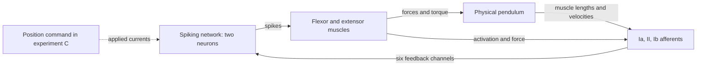

# Inverted physical pendulum balance with a spiking controller

[Русский](README.md)

## The problem

We investigate whether a small spiking neural network can hold a physical pendulum at its unstable upright equilibrium and return it there from different initial deviations. Two antagonistic muscles, a flexor and an extensor, drive the pendulum. The controller consists of two spiking neurons.

The central idea is **control through afferent feedback without explicitly encoding the measured angle**. The network receives six model signals, Ia, II and Ib from each muscle. These depend on muscle length, lengthening velocity, activation and force. Spikes change muscle activation; muscle forces rotate the pendulum; the resulting mechanical state feeds back through the afferents.



Measured angle, angular velocity and target error are not supplied as separate control inputs to the network. They are used by the mechanical model, quality evaluation and plotting. There is no PD/PID controller in the loop. In C, the desired position is communicated through external applied currents; afferents still provide feedback about actual movement.

## Four subproblems

### A — the system's general ability to balance

[A_balance](experiments/A_balance/README.en.md) tests whether the neuromuscular system can reach and maintain upright equilibrium from different initial angles and velocities. Both applied currents are zero. A genetic algorithm searches neuron, synapse, muscle and afferent-feedback parameters. Neuromuscular weights have broad bounds, `0.0001 ≤ w ≤ 1`. This establishes the capabilities of the chosen architecture before imposing further restrictions.

### B — balance with strict neuromuscular weight constraints

[B_balance](experiments/B_balance/README.en.md) addresses the same balance task while restricting excitation transfer from neurons to muscles. It asks whether balance remains possible within a narrower range of neuromuscular synaptic weights. Applied currents remain zero; initial conditions and the quality criterion match A.

The current configuration constrains both weights to `0.02 ≤ w < 0.1`. It also fixes both force-generation coefficients at `muscles.*.A = 0.37`; this is a muscle parameter, distinct from experiment A. There are 48 free parameters instead of A's 50. The previously completed B study used `0.0001 ≤ w ≤ 0.02` and mutable force-generation coefficients. The new study changes two factors simultaneously, so comparison with the previous study cannot isolate the effect of weight bounds alone.

### C — commanding a desired position through an input signal

In [C_setpoint_balance](experiments/C_setpoint_balance/README.en.md), one individual jointly encodes the controller and two current-command polynomials. Every candidate is evaluated on all five targets: −45°, −22.5°, 0°, +22.5° and +45°. A cubic genome has 60 physical fields and 56 mutable coordinates: 48 controller parameters and eight coefficients. Geometry and both muscle A=0.37 values are fixed; C retains 0.0001 ≤ w ≤ 1.

`joint` optimizes the network and polynomials from the start. `staged` first optimizes a common network and a five-target current table, fits bounded least-squares polynomials, then jointly refines the network and coefficients. Both methods receive equal total generation budgets. B's winner seeds the initial population, but its parameters subsequently evolve too. Currents depend only on the desired angle and remain constant within each episode.

C uses 40 training episodes (5 targets × 8 starts), 108 validation episodes (9 × 12), and 408 test episodes (17 × 24). Initial angles and speeds span −50…+50° and −1…+1 rad/s. Intermediate targets test interpolation; only the overall validation winner receives the independent test. CLI defaults remain replay; training requires `--mode joint`, `staged`, or `compare` (with `run_sweep.py`).

### D — continuous angle tracking

[D_trajectory](experiments/D_trajectory/README.en.md) provides a stateful `AngleController`: `advance(angle, duration_s)` updates a desired-angle command without resetting any physical state. Commands may arrive every 10 ms while the internal step remains 0.1 ms. C genomes already encode angle-to-current polynomials; D tests continuous sinusoids and compares polynomial-only with joint controller refinement. D uses an explicit moving-reference tracking score. Method and genome selection use validation before the independent test.

## Shared model and evaluation

The model uses full nonlinear `SpikingNN.core.Izh_net.Afferents`, a **0.1 ms** integration step and physical muscle torque without ×10 amplification. Angles are measured from upright: `θ = 0°` is the unstable equilibrium. Mass, link length, viscosity and gravity are configured hyperparameters. The shared controller block contains 52 physical fields; geometry `a1`, `a2` is always fixed.

A/B training, validation and independent test banks contain 24, 48 and 96 initial conditions, respectively, spanning **−50…+50°** and **−1…+1 rad/s**. Banks are fixed and identical between A/B. Each episode lasts **10 s**; crossing ±90° is a fall. Success requires entering the ±3° target-error and ±0.35 rad/s velocity bands by 3 s and staying within them until the episode ends.

Training searches the training bank, selection uses validation, and the winner is then evaluated on the independent test bank. Additional diagnostics comprise 100 starts on a 10×10 phase grid and ten starts at zero velocity. Neither test nor diagnostic-grid outcomes are used for selection. See the [model description](experiments/MODEL_METHODS.en.md) for equations, genome fields and the fitness function.

## Project structure

```text
AfferentBalance2026/
├── experiments/                 # Model, training and the four experiments
│   ├── simulation.py            # Neurons, muscles, pendulum, afferents, condition banks
│   ├── visualization.py         # Solution loading and shared plots
│   ├── core/                    # Genome, fitness, genetic algorithm, persistence
│   ├── A_balance/               # Balance with broad weight bounds
│   ├── B_balance/               # Balance with constrained neuromuscular transmission
│   ├── C_setpoint_balance/      # Position commands through external currents
│   └── D_trajectory/            # Stateful angle commands and trajectory tracking
├── tools/                       # Audits, diagnostics, winner selection and paths
├── tests/                       # Model, training and reproducibility checks
├── report/                      # Reports, article materials and figure notebooks
├── requirements.txt             # Numerical-code dependencies
├── requirements-notebook.txt    # Jupyter and interactive-display dependencies
├── pytest.ini                   # Test discovery configuration
├── DEVELOPMENT.md               # Validation commands and development rules
└── ARTICLE_FIGURES.md            # Article multipanel protocol
```

- **[experiments/](experiments/README.en.md)** contains the active physical model and experiment definitions. [core/](experiments/core/README.en.md) contains `genome.py` for parameters and constraints, `fitness.py` for scoring, `evolution.py` for genetic operators, and `run.py` for training, sweeps and storage.
- **[tools/](tools/README.en.md)** provides structure validation, B diagnostics, sweep-winner selection and historical-data helpers.
- **[tests/](tests/)** checks accelerated-model agreement with library classes, genome bounds, training, generation storage, plots and path resolution.
- **[report/](report/README.en.md)** contains the report and appendices, PDF builders, the [article-figure notebook](report/article_figures.ipynb) and the [report-figure notebook](report/edit_figures.ipynb). `Afferents2026/` contains article materials, `presentation_20261015/` a presentation, `analytical/` analytical estimates, and `pdf_build/` PDF build files. These materials describe earlier studies; current A/B/C/D results live beside their experiments. Some old numerical data have been removed and must be restored before using the historical builders.

### Inside A, B, C and D

| File or directory | Purpose |
|---|---|
| `README.md`, `README.en.md` | Experiment objective, constraints and commands |
| `genome_cfg.json` | Parameters, bounds, fixed values, mechanics and simulation settings |
| `run_experiment.py` | Training in A/B/C; C also supports replay, D compares and refines controllers |
| `run_sweep.py` | A training sweep; C also supports target/initial-condition grids |
| `explore_genome.ipynb` | Genome selection, phase trajectories, time traces and subsystem states |
| `results/` | Outputs belonging to this experiment |
| `C_setpoint_balance/polynomial_study.py` | Applied-current laws and their separately invoked fitting procedure |
| `C_setpoint_balance/joint_study.py` | Joint genome, multi-target scoring, least squares and method comparisons |
| `B_balance/DIAGNOSIS.md` | Analysis of the previous B configuration |

A/B training outputs follow this structure; study names depend on the run:

```text
results/
├── best_genome.json             # Selected solution with its own configuration
├── summary.json, current.json   # Summary and pointer to the published study
└── sweep_*/                     # Population-size and mutation-probability sweep
    ├── summary.csv              # Checkpoint summary table
    ├── population_*/mutation_*/seed_*/
    │   ├── generations/         # Complete population at every generation
    │   ├── checkpoints/         # Checkpoints of uninterrupted training
    │   ├── best/                # Leading individuals and complete trajectories
    │   ├── cases.npz            # Actual initial-condition banks
    │   ├── history.csv          # Convergence history
    │   ├── final_population.npz
    │   ├── run.json             # Run settings and checksums
    │   └── source_snapshot.zip  # Sources used for computation
    └── selected/                # New B winner audit and diagnostics after processing
```

C replays live under `results/replay_*/`: `traces/` holds complete trajectories, `target_*/` holds per-target figures, and `result.json` records the summary. Explicit current-law training produces separate outputs. Numerical files and rendered figures are excluded from Git. The [experiment index](experiments/README.en.md) describes the formats in detail.

## Exploring or repeating an experiment

Open an experiment's `explore_genome.ipynb` with the **SpikingNN (.venv)** kernel. It loads the local `results/best_genome.json` by default when available. Replay respects the selected solution's saved configuration; choosing a previous B genome preserves its previous constraints. Set `GENOME_PATH` to select another solution. Training flags are disabled by default in all notebooks. C reads `results/current_joint.json` when available and loads the joint genome with its current law; saved population generations are also supported.

From the SpikingNN repository root:

```bash
.venv/bin/jupyter lab scripts/AfferentBalance2026/experiments/A_balance/explore_genome.ipynb
.venv/bin/python -m pytest -c scripts/AfferentBalance2026/pytest.ini scripts/AfferentBalance2026/tests -q
```

Training commands are in the [A](experiments/A_balance/README.en.md), [B](experiments/B_balance/README.en.md) and [C](experiments/C_setpoint_balance/README.en.md) READMEs. Dependencies are listed in [requirements.txt](requirements.txt) and [requirements-notebook.txt](requirements-notebook.txt); validation guidance is in [DEVELOPMENT.en.md](DEVELOPMENT.en.md). Old genomes with currents in slots 46/47 require explicit conversion: these slots now hold geometry `a1/a2`.

## Results obtained

Status as of **21 October 2026**. The completed A, previous B and new B studies each ran 12 training lines: populations 10/30/50/100, mutation probabilities 0.1/0.3/0.6, seed 42. Each line continued for 200 generations with checkpoints at 30/60/100/150/200, preserving 2400 generations and 60 checkpoints per study.

| Study | Validation selection: population / mutation / generation | Independent test | Test late RMSE | Phase grid |
|---|---|---|---|---|
| [A: `0.0001 ≤ w ≤ 1`](experiments/A_balance/results/summary.json) | 100 / 0.1 / 200 | **96/96** | **0.018°** | **100/100** |
| [Previous B: `0.0001 ≤ w ≤ 0.02`, mutable force coefficient](experiments/B_balance/results/sweep_20261021/previous_selection/summary.json) | 30 / 0.1 / 100 | **39/96** | **53.558°** | **40/100** |
| [New B: `0.02 ≤ w < 0.1`, fixed `A=0.37`](experiments/B_balance/results/summary.json) | 50 / 0.1 / 200 | **96/96** | **0.004013°** | **100/100** |

**A:** a controller held upright equilibrium in every evaluated independent test and on the additional grid. The initial untrained genome succeeded in 0/96 test cases. This demonstrates afferent-feedback balance under the evaluated conditions.

**B:** the previous configuration achieved successful balance from a subset of starts. The 39/96 and 40/100 outcomes belong to that saved genome. Retraining is complete: the new winner passed 96/96 independent tests, 100/100 phase-grid cases and another 10/10 starts at zero velocity. The winner is published at `B_balance/results/best_genome.json`; full trajectories and plots are under `results/sweep_restored_weights_A037_20261021/selected/`.

**C:** the [control study](experiments/C_setpoint_balance/results/summary.json) used A's best genome and zero currents. It evaluated 550 trajectories: 100 phase-grid starts and ten zero-velocity starts for each of five targets.

| Target angle | Successful phase-grid starts | Late RMSE on that grid |
|---|---|---|
| −45° | 0/100 | 45.004° |
| −22.5° | 0/100 | 22.504° |
| 0° | **100/100** | **0.019°** |
| +22.5° | 0/100 | 22.496° |
| +45° | 0/100 | 44.996° |

With identical zero currents, the target changes only trajectory scoring while the system continues to stabilize upright. That control series did not train position commands.

**C pilot, 22 October 2026:** the joint-training study (historical pilot; its artifacts were subsequently removed) compared cubic `joint` and `staged` runs with 20 individuals, 30 total generations, p=0.1 and seed=42. Validation fitness was 0.34835 and 0.31094, respectively. The selected `joint` candidate passed **76/408 (18.63%)** independent tests; mean late RMSE was **7.95°**, and worst-target success was 0%. Reliable control across the range has not been achieved. All generations, the complete genome and 15 full trajectories are saved separately from the earlier control. This is a single-seed pilot, not a completed convergence study.

Late RMSE is averaged across episodes; falls receive a 90° penalty, so B's value is not the tracking error of successful trajectories alone. A single seed and finite initial-condition banks do not establish global stability or reproducibility across arbitrary training runs.

## Completed C sweep, 22 October 2026

Completed 16 lines: two methods, degrees 2/3, populations 30/50, mutation probabilities 0.1/0.3, seed=42, 200 total generations each. Staged splits the budget into 100 table and 100 polynomial generations. Training uses five targets, validation nine and independent testing seventeen. Fresh test initial-state seed: 2026102213.

| Method | Degree | Population | Mutation | Validation | Independent test | Late RMSE (deg) | Phase grid |
|---|---:|---:|---:|---:|---:|---:|---:|
| joint | 2 | 30 | 0.1 | 0.969244 | 408/408 | 0.469522 | 500/500 |
| staged | 3 | 50 | 0.1 | 0.902371 | 402/408 | 0.886729 | 498/500 |

Both method winners and the overall winner were selected by validation alone. Quadratic joint performed best in this sweep; one seed cannot establish statistical method superiority. Each solution has five targets × a 10×10 start grid (−50…50°, −1…1 rad/s), plus 50 zero-speed trajectories and one predeclared example: target +22.5°, start −30°, zero speed. Integration and recording use 0.1 ms; episodes last 10 s.

[Complete result index, genomes and figures](experiments/C_setpoint_balance/results/joint_sweep_20261022/README.en.md). The joint example uses constant currents **−31.4123513 and 238.3142774 nA**. This study and the pilot are preserved; retraining with a 5.1 ms floor is described below.

The current C repeat study constrains all four muscle times to 5.1–100 ms. Previous winners already had times >5 ms; retraining with seed 43 is described in the [C protocol](experiments/C_setpoint_balance/README.en.md#c-retraining-relaxation-times-5-ms).
