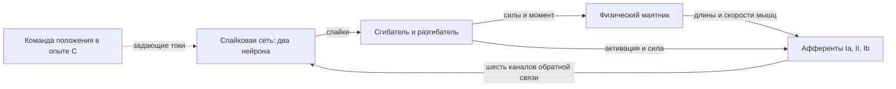

# Баланс перевёрнутого физического маятника со спайковым контроллером

[English](README.en.md)

## Какую задачу мы решаем

Мы исследуем, может ли небольшая спайковая нейронная сеть удерживать физический
маятник в верхнем, неустойчивом положении и возвращать его к равновесию после
начального отклонения. Маятник приводится в движение двумя мышцами-антагонистами:
сгибателем и разгибателем. Контроллер состоит из двух спайковых нейронов.

Главная особенность — **управление через афферентную обратную связь без явного
кодирования измеренного угла**. Сеть получает шесть модельных сигналов Ia, II, Ib
от двух мышц. Они зависят от длины и скорости удлинения мышцы, её активации и силы.
Спайки изменяют активацию мышц, мышечные силы поворачивают маятник, а изменение
механического состояния возвращается в сеть через афференты.



Измеренные угол, угловая скорость и ошибка относительно цели не подаются в сеть
как отдельные управляющие входы. Они используются в механической модели,
оценке качества и построении графиков. ПД/ПИД-регулятора в контуре нет.
В опыте C желаемое положение передаётся внешними задающими токами; обратная связь
о фактическом движении по-прежнему поступает от афферентов.

## Четыре подзадачи

### A — общая способность системы к равновесию

В [A_balance](experiments/A_balance/README.md) проверяем, способна ли сама
нейромышечная система найти и удерживать верхнее равновесие при разных начальных
углах и скоростях. Оба задающих тока равны нулю. Генетический алгоритм подбирает
параметры нейронов, синапсов, мышц и афферентной связи. Нейромышечные веса имеют
широкий диапазон `0.0001 ≤ w ≤ 1`. Это исходная проверка возможностей архитектуры,
с которой сопоставляются последующие ограничения.

### B — баланс при жёстких ограничениях нейромышечных весов

В [B_balance](experiments/B_balance/README.md) решаем ту же задачу равновесия,
но ограничиваем передачу возбуждения от нейронов к мышцам. Цель — выяснить,
сохраняется ли способность к балансу при более узком диапазоне весов
нейромышечного синапса. Токи остаются нулевыми; начальные условия и критерий
качества совпадают с A.

В текущей конфигурации оба веса ограничены диапазоном `0.02 ≤ w < 0.1`.
Дополнительно у обеих мышц фиксирован коэффициент образования силы
`muscles.*.A = 0.37`; это параметр мышцы, а не обозначение опыта A.
Свободны 48 параметров вместо 50 в A. Предыдущая завершённая серия B использовала
`0.0001 ≤ w ≤ 0.02` и изменяемый коэффициент силы. Новая серия меняет два фактора
одновременно, поэтому сравнение с прежней серией не выделяет только влияние весов.

### C — заданное положение по входному сигналу

В [C_setpoint_balance](experiments/C_setpoint_balance/README.md) одна особь
совместно кодирует контроллер и два полинома задающих токов. Каждый кандидат
оценивается на всех пяти целях: −45°, −22,5°, 0°, +22,5°, +45°.
Кубический вариант содержит 60 физических полей и 56 свободных координат:
48 параметров контроллера и 8 коэффициентов. Геометрия и оба мышечных A=0,37
фиксированы; границы весов C сохранены: 0,0001 ≤ w ≤ 1.

Два режима обучения: `joint` сразу меняет сеть и полиномы; `staged` сначала
меняет общую сеть и таблицу токов для пяти целей, затем аппроксимирует таблицу
ограниченным МНК и совместно дообучает сеть и полиномы. Бюджет эпох между
режимами одинаков. Лучший B служит стартовой особью, после чего его параметры
также меняются. Токи зависят только от заданного угла и постоянны в эпизоде.

Для C используются 40 обучающих сценариев (5 целей × 8 начальных условий),
108 валидационных (9 × 12) и 408 тестовых (17 × 24). Начальные углы и скорости:
−50…+50° и −1…+1 рад/с. Промежуточные цели проверяют интерполяцию;
только общий победитель по валидации проходит независимый тест.
Обычный запуск CLI остаётся воспроизведением; обучение включается явно
через `--mode joint`, `staged` или `compare` (в `run_sweep.py`).

### D — слежение за меняющимся углом

В [D_trajectory](experiments/D_trajectory/README.md) класс `AngleController` принимает желаемый угол и продолжает динамику без сброса состояний. `advance(angle, duration_s)` позволяет обновлять команду, например каждые 10 мс, с внутренним шагом 0,1 мс. Геном C уже содержит полиномы угла в токи; D проверяет их на непрерывных синусоидах и сравнивает дообучение только полиномов с совместным дообучением сети. Здесь используется отдельная оценка слежения за движущейся целью. Метод и лучший геном выбираются по валидации до независимого теста.

## Общая модель и оценка

Используются полные нелинейные афференты `SpikingNN.core.Izh_net.Afferents`,
шаг интегрирования **0,1 мс** и физический момент мышц без усиления ×10.
Угол отсчитывается от верхней вертикали: `θ = 0°` соответствует неустойчивому
равновесию. Масса, длина звена, вязкость и гравитация заданы конфигурацией.
Общий блок контроллера содержит 52 физических поля; геометрические `a1`, `a2` всегда фиксированы.

В A/B обучение, валидация и независимый тест используют соответственно
24, 48 и 96 начальных условий из диапазонов **−50…+50°** и **−1…+1 рад/с**.
Банки фиксированы и одинаковы для A/B. Эпизод длится **10 с**; выход за ±90°
считается падением. Успех требует войти в полосу ошибки угла ±3° и скорости
±0,35 рад/с не позднее 3 с и оставаться в ней до конца эпизода.

Параметры подбираются по обучающему банку, победитель выбирается по валидации,
затем проверяется на независимом тесте. Дополнительная диагностика включает
100 стартов на фазовой сетке 10×10 и ещё 10 стартов при нулевой скорости.
Тест и диагностическая сетка не участвуют в отборе. Уравнения, состав генома
и функция качества описаны в [модели](experiments/MODEL_METHODS.md).

## Структура проекта

```text
AfferentBalance2026/
├── experiments/                 # Модель, обучение и четыре постановки
│   ├── simulation.py            # Нейроны, мышцы, маятник, афференты, банки условий
│   ├── visualization.py         # Загрузка решений и общие графики
│   ├── core/                    # Геном, фитнесс, генетический алгоритм, сохранение
│   ├── A_balance/               # Баланс с широкими границами весов
│   ├── B_balance/               # Баланс с ограничениями нейромышечной передачи
│   ├── C_setpoint_balance/      # Задание положения внешними токами
│   └── D_trajectory/            # Непрерывные команды угла и слежение
├── tools/                       # Аудит, диагностика, выбор победителей, пути
├── tests/                       # Проверки модели, обучения и воспроизводимости
├── report/                      # Отчёты, материалы статьи и тетрадки рисунков
├── requirements.txt             # Зависимости расчётного кода
├── requirements-notebook.txt    # Зависимости Jupyter и интерактивного вывода
├── pytest.ini                   # Правила поиска тестов
├── DEVELOPMENT.md               # Запуск проверок и правила разработки
└── ARTICLE_FIGURES.md            # Протокол многопанельных рисунков статьи
```

- **[experiments/](experiments/README.md)** содержит действующую физическую модель
  и все постановки опытов. В [core/](experiments/core/README.md) находятся
  `genome.py` (параметры и ограничения), `fitness.py` (оценка качества),
  `evolution.py` (генетические операции), `run.py` (обучение, серии и сохранение).
- **[tools/](tools/README.md)** содержит служебные команды: проверку структуры,
  диагностику B, выбор победителя серии и помощники для исторических данных.
- **[tests/](tests/)** проверяет соответствие ускоренной модели библиотечным
  классам, ограничения генома, обучение, сохранение поколений, графики и пути.
- **[report/](report/README.md)** хранит отчёт и приложения, код сборки PDF,
  [тетрадку рисунков статьи](report/article_figures.ipynb) и
  [тетрадку рисунков отчёта](report/edit_figures.ipynb). В `Afferents2026/`
  находятся материалы статьи, в `presentation_20261015/` — презентация,
  в `analytical/` — аналитические оценки, в `pdf_build/` — файлы сборки PDF.
  Эти материалы описывают прежние серии; текущие результаты A/B/C/D лежат рядом
  с опытами. Часть старых численных данных удалена, поэтому исторические
  построители требуют их восстановления.

### Что находится внутри A, B, C и D

| Файл или каталог | Назначение |
|---|---|
| `README.md`, `README.en.md` | Постановка конкретного опыта, ограничения и команды |
| `genome_cfg.json` | Параметры, границы, фиксированные значения, механика и условия расчёта |
| `run_experiment.py` | Запуск обучения A/B/C; C также поддерживает воспроизведение, D — сравнение и дообучение |
| `run_sweep.py` | Серия обучений; C также поддерживает сетку целей и начальных условий |
| `explore_genome.ipynb` | Выбор генома, фазовые траектории, временные ряды и состояния подсистем |
| `results/` | Локальные результаты именно этого опыта |
| `C_setpoint_balance/polynomial_study.py` | Закон задающих токов и отдельный подбор его коэффициентов |
| `C_setpoint_balance/joint_study.py` | Совместный геном, пятицелевая оценка, МНК и сравнительное обучение |
| `B_balance/DIAGNOSIS.md` | Разбор результатов прежней конфигурации B |

Результаты обучения A/B организованы так; названия серий зависят от запуска:

```text
results/
├── best_genome.json             # Выбранное решение с собственной конфигурацией
├── summary.json, current.json   # Сводка и указатель на опубликованную серию
└── sweep_*/                     # Серия размеров популяции и вероятностей мутации
    ├── summary.csv              # Сводная таблица контрольных точек
    ├── population_*/mutation_*/seed_*/
    │   ├── generations/         # Вся популяция каждого поколения
    │   ├── checkpoints/         # Контрольные срезы продолжающегося обучения
    │   ├── best/                # Лучшие особи и их полные траектории
    │   ├── cases.npz            # Использованные банки начальных условий
    │   ├── history.csv          # История сходимости
    │   ├── final_population.npz
    │   ├── run.json             # Параметры запуска и контрольные суммы
    │   └── source_snapshot.zip  # Исходники, использованные при расчёте
    └── selected/                # Аудит и диагностика нового B после обработки
```

В C повторные симуляции находятся в `results/replay_*/`: `traces/` содержит
полные траектории, `target_*/` — графики для каждой цели, `result.json` — сводку.
Результаты явного обучения закона токов сохраняются отдельно от этих проверок.
Численные файлы и готовые изображения исключены из Git. Подробное описание
форматов — в [каталоге экспериментов](experiments/README.md).

## Как изучить или повторить опыт

Для просмотра откройте `explore_genome.ipynb` нужного опыта в ядре
**SpikingNN (.venv)**. По умолчанию загружается локальный
`results/best_genome.json`, если он существует. Его сохранённая конфигурация
определяет параметры воспроизведения. При выборе генома прежнего B сохраняются
прежние ограничения. `GENOME_PATH` позволяет выбрать другое решение.
Флаги обучения во всех тетрадках выключены по умолчанию. Тетрадка C читает
`results/current_joint.json`, если он существует, и загружает совместный геном
вместе с законом токов; доступны также полные популяции сохранённых эпох.

Из корня репозитория SpikingNN:

```bash
.venv/bin/jupyter lab scripts/AfferentBalance2026/experiments/A_balance/explore_genome.ipynb
.venv/bin/python -m pytest -c scripts/AfferentBalance2026/pytest.ini scripts/AfferentBalance2026/tests -q
```

Команды обучения приведены в README [A](experiments/A_balance/README.md),
[B](experiments/B_balance/README.md) и [C](experiments/C_setpoint_balance/README.md).
Зависимости — в [requirements.txt](requirements.txt) и
[requirements-notebook.txt](requirements-notebook.txt), правила проверок —
в [DEVELOPMENT.md](DEVELOPMENT.md). Старые геномы с токами в полях 46/47 требуют
явного преобразования: в текущей схеме эти поля содержат геометрию `a1/a2`.

## Полученные результаты

Состояние на **21 октября 2026 года**. В завершённых сериях A, прежнего B и нового B
выполнено по 12 обучений: популяции 10/30/50/100, вероятности мутации
0,1/0,3/0,6, seed 42. Каждая линия продолжалась до 200 поколений со срезами
30/60/100/150/200; сохранено по 2400 поколений и 60 контрольных точек.

| Серия | Выбор по валидации: популяция / мутация / поколение | Независимый тест | Поздняя RMSE теста | Фазовая сетка |
|---|---|---|---|---|
| [A: `0.0001 ≤ w ≤ 1`](experiments/A_balance/results/summary.json) | 100 / 0,1 / 200 | **96/96** | **0,018°** | **100/100** |
| [Прежний B: `0.0001 ≤ w ≤ 0.02`, изменяемый коэффициент силы](experiments/B_balance/results/sweep_20261021/previous_selection/summary.json) | 30 / 0,1 / 100 | **39/96** | **53,558°** | **40/100** |
| [Новый B: `0.02 ≤ w < 0.1`, фиксированный `A=0.37`](experiments/B_balance/results/summary.json) | 50 / 0,1 / 200 | **96/96** | **0,004013°** | **100/100** |

**A:** найдена система, удерживающая верхнее равновесие во всех выполненных
независимых тестах и на дополнительной сетке. Исходный необученный геном имел
0/96 успешных тестов. Это подтверждает возможность баланса через афферентную
связь для исследованных условий.

**B:** в прежней конфигурации успешное удержание получено для части стартов.
Результаты 39/96 и 40/100 относятся именно к её сохранённому геному.
Повторное обучение завершено: новый победитель прошёл 96/96 независимых тестов,
100/100 условий фазовой сетки и ещё 10/10 стартов при нулевой скорости.
Лучший геном опубликован в `B_balance/results/best_genome.json`; полные траектории
и графики — в `sweep_restored_weights_A037_20261021/selected/` внутри `results/`.

**C:** [контрольная серия](experiments/C_setpoint_balance/results/summary.json)
использовала лучший геном A и нулевые токи. Выполнено 550 траекторий:
для каждой из пяти целей — 100 стартов фазовой сетки и 10 при нулевой скорости.

| Целевой угол | Успешные старты фазовой сетки | Поздняя RMSE на этой сетке |
|---|---|---|
| −45° | 0/100 | 45,004° |
| −22,5° | 0/100 | 22,504° |
| 0° | **100/100** | **0,019°** |
| +22,5° | 0/100 | 22,496° |
| +45° | 0/100 | 44,996° |

При одинаковых нулевых токах цель меняет только оценку траектории, а система
продолжает стабилизировать вертикаль. Для управления произвольным заданным
положением эта контрольная серия не обучалась.

**Пилот C от 22 октября 2026:** совместное обучение (исторический пилот; его файлы позднее удалены)
сравнило кубические `joint` и `staged`: 20 особей, 30 эпох общего бюджета,
p=0,1, seed=42. Валидация: 0,34835 и 0,31094 соответственно. Выбран `joint`;
независимый тест дал **76/408 (18,63%)**, среднюю позднюю RMSE **7,95°**,
минимальную успешность по целям 0%. Удержание всего диапазона пока не достигнуто.
Все поколения, полный геном и 15 полных траекторий сохранены отдельно
от прежнего контроля. Это пилот одного seed, не завершённая серия сходимости.

Поздняя RMSE усредняется по эпизодам; падение получает штраф 90°, поэтому
значение B не является ошибкой только успешно удержанных траекторий.
Один seed и конечные наборы начальных условий не доказывают глобальную
устойчивость и воспроизводимость результата для любых запусков обучения.

## Завершённый sweep C, 22 октября 2026

Рассчитаны 16 линий: два способа, степени 2/3, популяции 30/50, вероятности мутации 0,1/0,3, seed=42, по 200 эпох общего бюджета. В staged бюджет разделён на 100 эпох таблицы и 100 эпох полинома. Обучение на пяти целях; валидация на девяти, независимый тест на семнадцати. Новый seed тестовых начальных условий: 2026102213.

| Method | Degree | Population | Mutation | Validation | Independent test | Late RMSE (deg) | Phase grid |
|---|---:|---:|---:|---:|---:|---:|---:|
| joint | 2 | 30 | 0.1 | 0.969244 | 408/408 | 0.469522 | 500/500 |
| staged | 3 | 50 | 0.1 | 0.902371 | 402/408 | 0.886729 | 498/500 |

Выбор обоих геномов и общего победителя выполнен только по валидации. Квадратичный joint лучше в этой серии; один seed не доказывает статистического превосходства метода. Сетка каждого решения: пять целей × 10×10 стартов (−50…50°, −1…1 рад/с). Дополнительно сохранено по 50 траекторий при нулевой скорости и по одному заранее выбранному примеру: цель +22,5°, старт −30°, скорость 0. Шаг расчёта и записи 0,1 мс, длительность 10 с.

[Все файлы серии, геномы и графики](experiments/C_setpoint_balance/results/joint_sweep_20261022/README.md). Для примера joint токи: **−31,4123513 и 238,3142774 нА**, постоянные на эпизод. Эта серия и прежний пилот сохранены; повторное обучение с границей 5,1 мс описано ниже.

Текущая повторная серия C ограничивает все четыре мышечных времени диапазоном 5,1–100 мс. Предыдущие победители уже имели времена >5 мс; повторное обучение с seed 43 описано в [протоколе C](experiments/C_setpoint_balance/README.md#повторное-обучение-c-времена-релаксации-5-мс).
