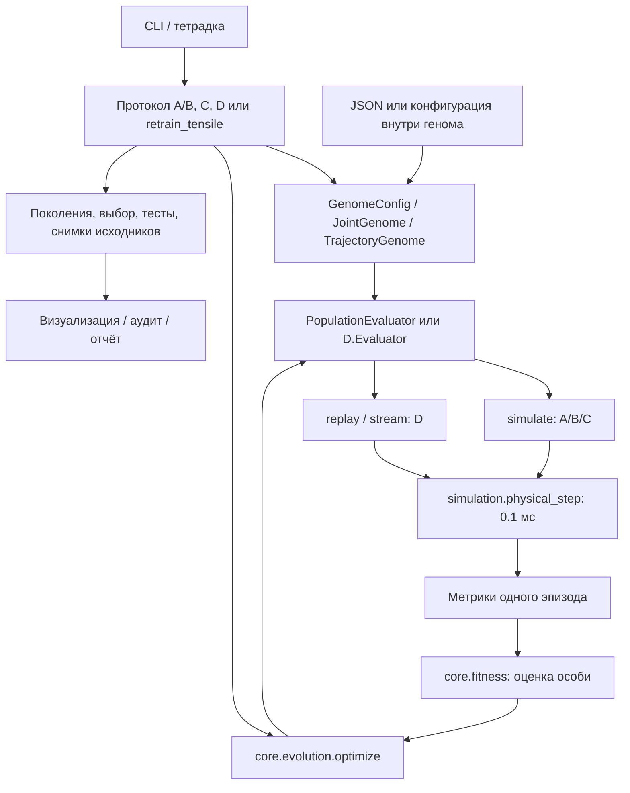

# Устройство AfferentBalance2026: файлы, команды, геном и вычисления

Дата разбора: **27 октября 2026 года**. Описание сверено с текущими исходниками и JSON в рабочем каталоге, включая ещё не закоммиченные файлы. Это описание существующей реализации; предложения по её изменению вынесены в конец. Научное обучение и пересчёт сохранённых результатов при подготовке документа не запускались.

**Основная трудность проекта — несколько разных способов запуска и выбора конфигурации.** Физический шаг и генетические операции уже общие. Однако A/B, совместное обучение C, исследование D и дообучение через `tools/retrain_tensile.py` по-разному получают настройки, выбирают победителей и записывают результаты. Поэтому одинаковые названия файлов и ключей ещё не означают одинаковое поведение.

Документ охватывает все 59 Python-файлов, видимых обычному `rg --files`, конфигурации, тетрадки, документацию и отдельно локальные материалы `report/`, скрытые правилами Git. Тысячи однотипных вычисленных файлов описаны по форматам и шаблонам имён, а не по каждому номеру поколения или испытания. Снимки старых исходников внутри результатов рассматриваются как архивы, а не как действующий код.

## Содержание

1. [Карта каталогов и назначение каждого исходного файла](#files)
2. [Основные команды и все их ключи](#commands)
3. [Как организованы вычисления](#computation)
4. [Конфигурация и состав генома](#configuration)
5. [Как менять геном и запускать обучение](#recipes)
6. [Форматы результатов и правила загрузки](#artifacts)
7. [Работа с тетрадками](#notebooks)
8. [Проверки и зависимости](#checks)
9. [Подтверждённые проблемы понятности и согласованности](#problems)
10. [Предлагаемое упрощение](#proposal)

Быстрый маршрут для нового пользователя: выбрать A/B/C/D → прочитать таблицу команд → проверить источник конфигурации → изменить копию JSON или подготовить новый стартовый геном → выполнить короткую техническую проверку → запустить полный расчёт в новый каталог → открыть явно выбранный результат.

<a id="files"></a>

## 1. Карта каталогов и назначение файлов

### 1.1. Границы проекта

```text
SpikingNN/                                  # Внешний корень Python-проекта
├── src/SpikingNN/core/Izh_net.py             # Библиотечная модель, вне этой папки
├── setup.py                                # Установка пакета SpikingNN
├── .venv/                                  # Существующее окружение
└── scripts/AfferentBalance2026/             # Текущий каталог
    ├── experiments/
    │   ├── core/                           # Геном, GA, оценка популяции, запуск A/B
    │   ├── simulation.py                   # Общая физика и статические эпизоды
    │   ├── visualization.py                # Общие загрузчики и графики
    │   ├── notebook_runtime.py             # Выбор генома и обновление импортов
    │   ├── A_balance/                      # Баланс, широкие границы мышечных весов
    │   ├── B_balance/                      # Баланс, узкие границы весов
    │   ├── C_setpoint_balance/             # Постоянный заданный угол
    │   └── D_trajectory/                   # Непрерывно меняющийся заданный угол
    ├── tools/                              # Дообучение, подготовка, аудит, публикация
    ├── tests/                              # Проверки модели и протоколов
    ├── report/                             # Текст статьи, сборка, старые материалы
    ├── README.md, DEVELOPMENT.md, ARTICLE_FIGURES.md
    ├── *.en.md                             # Английские версии этих документов
    ├── requirements.txt, requirements-notebook.txt
    ├── pytest.ini, .gitignore
    └── STRUCT.md                           # Этот справочник
```

Эта папка **не является автономным установленным Python-пакетом**. Многие скрипты добавляют в `sys.path` корень SpikingNN через `Path(__file__).parents[...]`, затем импортируют `scripts.AfferentBalance2026...`. Для физики нужен также установленный `SpikingNN`. Простое копирование одной папки в другое место не гарантирует запуск.

### 1.2. Файлы в корне и общая документация

| Файл | Назначение и ограничения |
|---|---|
| [README.md](README.md), [README.en.md](README.en.md) | Введение, постановки A–D, маршруты запуска, исторические результаты. Часть чисел описывает прежние конфигурации; текущие значения нужно сверять с JSON. |
| [DEVELOPMENT.md](DEVELOPMENT.md), [DEVELOPMENT.en.md](DEVELOPMENT.en.md) | Правила разработки, команды проверок, журнал выполненных ранее проверок. Указанные количества прошедших тестов относятся к датам записей. |
| [ARTICLE_FIGURES.md](ARTICLE_FIGURES.md), [ARTICLE_FIGURES.en.md](ARTICLE_FIGURES.en.md) | Протокол исторических многопанельных рисунков, сетки начальных состояний и правила изображения фактических траекторий. |
| [requirements.txt](requirements.txt) | Дополнительные расчётные зависимости: Numba, Gymnasium, SciPy, Matplotlib. Предполагает предварительную установку основного SpikingNN. |
| [requirements-notebook.txt](requirements-notebook.txt) | Включает `requirements.txt`; добавляет JupyterLab, nbclient, ipywidgets, ipympl, ipykernel. |
| [pytest.ini](pytest.ini) | Поиск тестов в `tests`; исключение архивов, отчётов и результатов из рекурсивного сбора. |
| [.gitignore](.gitignore) | Правила исключения результатов и большинства локальных материалов отчёта; явные исключения для редактируемых исходников. Наличие файла на диске не означает его наличие в Git. |
| `STRUCT.md` | Карта текущей реализации, справочник настроек и план упрощения. |
| [experiments/README.md](experiments/README.md), [experiments/README.en.md](experiments/README.en.md) | Обзор вычислительных постановок и структуры результатов. |
| [experiments/MODEL_METHODS.md](experiments/MODEL_METHODS.md), [experiments/MODEL_METHODS.en.md](experiments/MODEL_METHODS.en.md) | Уравнения модели, геном и метод оценки; содержат также сведения о предшествующих протоколах. |
| [experiments/MIRROR_SYMMETRY.md](experiments/MIRROR_SYMMETRY.md), [experiments/MIRROR_SYMMETRY.en.md](experiments/MIRROR_SYMMETRY.en.md) | Правила точной зеркальной симметрии контроллера и закона токов, отдельная серия C/D. |

### 1.3. Общее вычислительное ядро

| Файл | Основные функции / классы | Что делает |
|---|---|---|
| [experiments/core/genome.py](experiments/core/genome.py) | `GenomeConfig`, `load_genome`, `import_legacy`, `project_mirror`, `write_json`, `file_hash` | Фиксирует схему 52 полей и их порядок (`NAMES`), проверяет JSON, переводит физические значения в независимые нормированные координаты и обратно, восстанавливает фиксированные поля. `MIRROR_INDICES` задаёт соответствие зеркальных пар. Сохранение генома включает исходную конфигурацию и SHA-256. |
| [experiments/core/evolution.py](experiments/core/evolution.py) | `Schedule.at`, `reflect`, `initial_population`, `reproduce`, `optimize` | Общий вещественный GA: начальная популяция, элитизм, турнир, смешивание родителей, мутация, отражение в `[0,1]`, история и callbacks. Не знает физического смысла генов. `resume_state` существует на уровне API, но CLI продолжения расчёта нет. |
| [experiments/core/fitness.py](experiments/core/fitness.py) | `fitness(metrics)` | Сводит матрицу метрик эпизодов `K×9` к одному числу; использует только столбец `score`. Больше — лучше. Сам критерий одного эпизода здесь не определён. |
| [experiments/core/run.py](experiments/core/run.py) | `PopulationEvaluator`, `_evaluate_task`, `train`, `sweep`, `balance_main`, `save_replays`, `source_hashes`, `write_csv` | Одновременно содержит общий процессный вычислитель, сохранение данных и конкретный протокол A/B с CLI. `train` выбирает по валидации лучшую особь последней популяции; `sweep` сохраняет промежуточные срезы одной непрерывной линии GA. |
| [experiments/simulation.py](experiments/simulation.py) | `simulate`, `_integrate`, `physical_step`, `initial_state`, `write_state`, `afferent_values`, `case_grid`, `balance_banks`, `reference_trace`, `measure_trace` | Единственный ускоренный физический шаг для A–D. Формирует статические эпизоды и банки начальных условий, считает метрики A/B/C. `reference_trace` независимо повторяет динамику библиотечными классами, `measure_trace` пересчитывает метрики из записи. Константы `CASE_COLUMNS`, `TRACE_COLUMNS`, `METRIC_COLUMNS` определяют форматы массивов. |
| [experiments/visualization.py](experiments/visualization.py) | `load_solution`, `replay_grid`, `parameter_scan`, `plot_phase`, `plot_angles`, `plot_states`, `plot_sweep`, `plot_condition_banks`, `configure_fonts` | Загрузка контроллеров A/B из JSON/NPZ; симуляция сеток; изменение одного свободного параметра; графики конечности, нейронов, мышц, афферентов и обучения. У симметричного генома `parameter_scan` меняет оба связанных поля. |
| [experiments/notebook_runtime.py](experiments/notebook_runtime.py) | `refresh_model_modules`, `resolve_genome_path`, `GENOME_VARIANTS` | Для C/D разрешает явный путь или именованный вариант генома. При изменениях исходников согласованно обновляет импорты кодеков в Jupyter. Не перезагружает физические интеграторы и не сбрасывает существующие контроллеры. |
| [experiments/core/README.md](experiments/core/README.md), [experiments/core/README.en.md](experiments/core/README.en.md) | — | Описание общего ядра; детали текущего поведения уточняются по коду. |
| [experiments/__init__.py](experiments/__init__.py), [experiments/core/__init__.py](experiments/core/__init__.py) | — | Обозначают пакеты; содержат только краткие docstring. |

Методы `GenomeConfig`: `initial()` возвращает начальную нормированную особь; `encode()` проверяет физическую особь и нормирует её; `decode()` восстанавливает 52 значения; `save()` пишет переносимый JSON; `size` — число **независимых**, а не всех физических полей; `signature` — хеш всей конфигурации, включая протокол и описания.

### 1.4. A_balance и B_balance

A и B используют одни и те же функции ядра. Их стартовые скрипты по 10 строк — полезные тонкие обёртки, а не два независимых алгоритма обучения.

| Файл | Назначение |
|---|---|
| [A_balance/run_experiment.py](experiments/A_balance/run_experiment.py) | Вызывает `balance_main(..., sweep_mode=False)` с локальным конфигом A. |
| [A_balance/run_sweep.py](experiments/A_balance/run_sweep.py) | Вызывает тот же CLI с `sweep_mode=True`. |
| [A_balance/genome_cfg.json](experiments/A_balance/genome_cfg.json) | Широкие веса `0.0001…1`, параметры физики, банки, GA и сетка серий. Сейчас обе мышечные `A=0.37` фиксированы: 48 свободных координат. |
| [A_balance/explore_genome.ipynb](experiments/A_balance/explore_genome.ipynb) | Просмотр выбранного генома/популяции, фазовая сетка, состояния, сканирование параметра; отдельно выключенные флаги обучения. |
| [A_balance/README.md](experiments/A_balance/README.md), [A_balance/README.en.md](experiments/A_balance/README.en.md) | Постановка A, инструкции и накопленная история результатов. |
| [A_balance/__init__.py](experiments/A_balance/__init__.py) | Маркер пакета, только docstring. |
| [B_balance/run_experiment.py](experiments/B_balance/run_experiment.py) | Та же одиночная тренировка, конфигурация B. |
| [B_balance/run_sweep.py](experiments/B_balance/run_sweep.py) | Та же серия GA, конфигурация B. |
| [B_balance/genome_cfg.json](experiments/B_balance/genome_cfg.json) | Веса `0.02 ≤ w < 0.1`, фиксированные `A=0.37`, 48 свободных координат. Строгая верхняя граница хранится как `0.09999999999999999`. |
| [B_balance/explore_genome.ipynb](experiments/B_balance/explore_genome.ipynb) | Аналог тетрадки A; загружает исходные ограничения выбранного сохранённого решения. |
| [B_balance/README.md](experiments/B_balance/README.md), [B_balance/README.en.md](experiments/B_balance/README.en.md) | Постановка и история B. |
| [B_balance/DIAGNOSIS.md](experiments/B_balance/DIAGNOSIS.md), [B_balance/DIAGNOSIS.en.md](experiments/B_balance/DIAGNOSIS.en.md) | Диагностика прежнего режима B; не универсальная инструкция запуска актуального обучения. |
| [B_balance/__init__.py](experiments/B_balance/__init__.py) | Маркер пакета, только docstring. |

### 1.5. C_setpoint_balance

| Файл | Основные функции / классы | Назначение |
|---|---|---|
| [run_experiment.py](experiments/C_setpoint_balance/run_experiment.py) | `run`, `main(grid=False)` | По умолчанию воспроизводит контроллер. Явные `--mode joint/staged` запускают обучение. `run` сохраняет исходные токи, траектории и происхождение; сам графики не строит. |
| [run_sweep.py](experiments/C_setpoint_balance/run_sweep.py) | Вызов `main(grid=True)` | В replay строит набор испытаний по сетке; в режиме обучения перебирает настройки. Только здесь разрешён `--mode compare`. |
| [joint_study.py](experiments/C_setpoint_balance/joint_study.py) | `JointGenome`, `load_joint_genome`, `load_joint_solution`, `target_banks`, `evaluate_joint`, `train_joint`, `fit_table_polynomial`, `run_pipeline`, `sweep_joint`, `finish_solution`, `summarize_targets`, `plot_solution` | Кодек «контроллер + команды», многоточечная оценка, обучение, выбор по контрольным точкам, переход от таблицы к полиномам через ограниченный МНК, независимый тест, экспорт и рисунки. Это один из главных узлов связности: содержит несколько разных обязанностей. |
| [polynomial_study.py](experiments/C_setpoint_balance/polynomial_study.py) | `polynomial_currents`, `load_current_law`, `fit_current_law` | Вычисляет токи по заданному углу. `fit_current_law` — отдельный Python API обучения только коэффициентов при неподвижном контроллере; штатный CLI его автоматически не вызывает. |
| [sweep_diagnostics.py](experiments/C_setpoint_balance/sweep_diagnostics.py) | `choose_method_winners`, `diagnose_winner`, `publish_methods`, `load_records`, `plot_example`, `read_rows`, `save_figure`, `main` | После sweep выбирает по валидации победителя каждого метода и создаёт `method_winners/`: тест, полные диагностические сетки, сигналы и рисунки. |
| [genome_cfg.json](experiments/C_setpoint_balance/genome_cfg.json) | — | 52 поля контроллера, `simulation`, `setpoint`, `ga`, `sweep`. Полиномиальные коэффициенты добавляет кодек, в `parameters` этого конфига их нет. |
| [explore_genome.ipynb](experiments/C_setpoint_balance/explore_genome.ipynb) | `command_for`, `run_on_grid`, `view_states`, `phase_portrait`, `scan_parameter` | Выбор совместного решения, его команд и начальных состояний; сравнение пяти целей. Обучение — отдельная ячейка с `RUN_STUDY=False`. |
| [README.md](experiments/C_setpoint_balance/README.md), [README.en.md](experiments/C_setpoint_balance/README.en.md) | — | Постановка и команды C с историческими дополнениями. |
| [GENOME_VERSIONS.md](experiments/C_setpoint_balance/GENOME_VERSIONS.md), [GENOME_VERSIONS.en.md](experiments/C_setpoint_balance/GENOME_VERSIONS.en.md) | — | Именованные опубликованные версии: быстрые мышцы, времена ≥50 мс, времена ≥50 мс с симметрией. |
| [__init__.py](experiments/C_setpoint_balance/__init__.py) | — | Маркер пакета. |

`JointGenome.encode/decode` объединяют контроллер и командный блок. `currents(command, cases)` возвращает токи для каждого эпизода. Таблица допустима только для своих заданных углов; интерполяции таблицы на произвольный угол нет. `save()` сохраняет полный совместный геном и описание команд.

### 1.6. D_trajectory

| Файл | Основные функции / классы | Назначение |
|---|---|---|
| [controller.py](experiments/D_trajectory/controller.py) | `TrajectoryGenome`, `load_solution`, `AngleController` | Кодек 52+8 физических полей и интерфейс управления без сброса состояния. Загружает D или полиномиальный C; квадратичный C дополняется нулевыми кубическими коэффициентами. |
| [trajectory.py](experiments/D_trajectory/trajectory.py) | `step_count`, `sine_case`, `sine_reference`, `trajectory_banks`, `command_currents`, `stream`, `replay`, `measure_tracking_trace` | Заданные синусоиды, плавное включение, фильтр токов, потоковая интеграция, специальные метрики слежения. Использует общий `physical_step`. |
| [run_experiment.py](experiments/D_trajectory/run_experiment.py) | `Evaluator`, `initialize_worker`, `evaluate_task`, `default_sources`, `train_mode`, `run_study`, `save_dynamics`, `summarize`, `main` | Сравнивает замороженные C-решения и времена фильтра; обучает `command_only` и `joint`; выбирает по валидации; затем пишет тесты и диагностику трёх решений. |
| [run_sweep.py](experiments/D_trajectory/run_sweep.py) | Вызов `main` из `run_experiment.py` | Сейчас это алиас того же исследования, отдельной сетки популяций/seed и отдельного парсера здесь нет. |
| [audit_trajectory.py](experiments/D_trajectory/audit_trajectory.py) | `audit`, `main` | Проверяет происхождение, популяции, выбор, метрики и траектории завершённого стандартного исследования D; сохраняет `audit.json`. |
| [plots.py](experiments/D_trajectory/plots.py) | `plot_study`, `save_figure` | Строит сравнения слежения, фазовых портретов, токов и внутренних состояний из сохранённых данных. |
| [genome_cfg.json](experiments/D_trajectory/genome_cfg.json) | — | 52 поля и механика; вместо `simulation/setpoint/ga` верхнего уровня используется `trajectory` с вложенным `ga`. |
| [explore_genome.ipynb](experiments/D_trajectory/explore_genome.ipynb) | `run_sine`, `view_states`, `phase_grid`, `scan_parameter`, `LivePendulumSimulation` | Обычные исследования и большая самодостаточная интерактивная ячейка с ползунком целевого угла. |
| [live_activity.ipynb](experiments/D_trajectory/live_activity.ipynb) | `RecordingAngleController`, `LivePendulumActivitySimulation` | Отдельная расширенная интерактивная тетрадка: нейронные сигналы, афференты и мышечные силы с записью каждого физического шага. Часть UI дублирует `explore_genome`. |
| [best_genome_bak261026.json](experiments/D_trajectory/best_genome_bak261026.json) | — | Локальная резервная копия решения схемы `afferent_trajectory_v1`, 60 физических полей. Это результат, не конфигурация обучения; стандартный код не выбирает его автоматически. |
| [README.md](experiments/D_trajectory/README.md), [README.en.md](experiments/D_trajectory/README.en.md) | — | Постановка слежения, интерфейс и история результатов. |
| [GENOME_VERSIONS.md](experiments/D_trajectory/GENOME_VERSIONS.md), [GENOME_VERSIONS.en.md](experiments/D_trajectory/GENOME_VERSIONS.en.md) | — | Каталог трёх физиологических вариантов опубликованных решений. |
| [__init__.py](experiments/D_trajectory/__init__.py) | Экспорт `AngleController` | В отличие от остальных `__init__`, импортирует публичный контроллер. |

Методы `AngleController`: `reset()` сбрасывает все состояния; присваивание `target_angle_deg` меняет только команду; `step()` проходит 0.1 мс; `advance(angle, duration_s)` удерживает угол на блоке времени; `snapshot()` возвращает копии наблюдений. После падения следующий `advance` требует явного `reset`. Это симулятор, а не аппаратный планировщик реального времени.

### 1.7. tools: вычисления, сопровождение и публикация

Названия `analyze`, `audit` и `finalize` не означают отсутствие записи на диск. Некоторые утилиты меняют общие указатели, копии победителей, документацию и тетрадки. Ниже это указано отдельно.

| Файл | Основные функции | Назначение, входы и результат |
|---|---|---|
| [retrain_tensile.py](tools/retrain_tensile.py) | `polarity_seeds`, `decode`, `save_genome`, `train_stage`, `main` | Фактически второй общий запускатель A–D: дообучает переносимый геном, сохраняет все поколения, оставляет исходную особь допустимым победителем по валидации. Конфигурацию получает **из генома**, не из локального JSON. Для C есть `staged`, для D — `command_only`. |
| [prepare_muscle_times.py](tools/prepare_muscle_times.py) | `prepare`, `main` | Переносит старое решение в явно заданные границы мышечных времён: четыре старта `clipped`, `clipped_gain_matched`, `reference`, `reference_gain_matched`. Пишет копию исходника, конфиг назначения, журнал изменений. Это специализированное преобразование, не универсальный конвертер любых генов. |
| [prepare_mirror_genome.py](tools/prepare_mirror_genome.py) | `prepare`, `main` | Создаёт симметричный C/D-старт: усредняет зеркальные физические пары и согласует чётность коэффициентов токов. Пишет `genome_cfg.json`, `best_genome.json`, `projection.json`. Качество исходного контроллера такая проекция не сохраняет. |
| [retraining_figures.py](tools/retraining_figures.py) | `evaluate_static`, `evaluate_dynamic`, `signals`, `save_figure`, `label_axes`, `main` | Для заданного запуска дообучения пересчитывает победителя, проверяет тестовые метрики, сохраняет сетки/сигналы и PNG/PDF в `figures/`. Это новые симуляции, а не только оформление старых графиков. |
| [finalize_retraining.py](tools/finalize_retraining.py) | `annotate`, `publish`, `main` | Обрабатывает фиксированную серию, заданную в сборщике отчёта. Добавляет метаданные в NPZ, формирует финальные популяции, выбирает победителей, обновляет `results/best_genome.json`, указатели и README. Меняет тетрадки и очищает их outputs. Сохраняет прежние текущие файлы в backup. CLI выбора произвольной серии нет. |
| [recheck_tensile_genomes.py](tools/recheck_tensile_genomes.py) | `candidates`, `load_candidate`, `run_bank`, `summarize`, `digest`, `write_json`, `main` | Повторно проверяет прежние победившие геномы при механике `v3-tensile`, без обучения. Источники перечислены в коде; новый `--tag` создаёт отдельные каталоги результатов. |
| [select_sweep_winner.py](tools/select_sweep_winner.py) | `audit`, `select`, `plot_replays`, `write_indexes`, `main` | Специализированный выбор победителя **B** с `0.02 ≤ w < 0.1` и `A=0.37`, несмотря на общее имя. Проверяет поколения и хеши, пересчитывает тест и диагностические траектории, публикует текущий B-геном и индексы. |
| [analyze_joint_sweep.py](tools/analyze_joint_sweep.py) | `audit`, `plot_comparison`, `write_fit_effects`, `write_summary`, `main` | Анализ стандартной серии C после `sweep_diagnostics.py`: аудит поколений/траекторий, влияние МНК, сравнения и RU/EN-сводки; обновляет `current_joint.json`. |
| [compare_muscle_relaxation.py](tools/compare_muscle_relaxation.py) | `compare`, `main` | Сравнивает уже выбранные решения двух C-серий на одинаковом банке, строит сравнения времён и сил. Параметры старых победителей не переобучает. |
| [summarize_mirror_study.py](tools/summarize_mirror_study.py) | `solution`, `verify_generations`, `confirmation`, `metrics_summary`, `publish_versions`, `command_line`, `learning_plot`, `target_plot`, `comparison_report`, `main` | Проверяет фиксированную серию `mirror_symmetry_20261026`, сравнивает с асимметричной базой и дополнительным банком, публикует именованные версии и дополнение к отчёту. Обновляет связанные индексы/тетрадки; это не общий анализатор любого каталога. |
| [diagnose_balance_b.py](tools/diagnose_balance_b.py) | `rescale_muscle_drive`, `frozen_export`, `run`, `plot_comparison`, `main` | Сопоставляет старый и текущий B без обучения. Исторический код запускается в отдельном процессе. Перенормировка `w/k` проверяет влияние ограничения мышечного входа; нужны старые данные и frozen runtime. |
| [analyze_unscaled.py](tools/analyze_unscaled.py) | `read`, `table`, `moment_capacity`, `document_report`, `analyze` | Аудит и отчёт исторической серии без усиления момента ×10. Зависит от её старых данных и исходников; не анализирует произвольный современный A–D-запуск. |
| [runtime_support.py](tools/runtime_support.py) | `resolve_recorded_path`, `current_results`, `runtime_directory`, `runtime_package_directory`, `recorded_runtime`, `activate_runtime`, `core_module` | Перенос старых путей `SteppingReflexGA`, поиск неизменяемого runtime, проверка его хешей и импорт. Не подменяет отсутствующий старый runtime живыми исходниками. |
| [layout.py](tools/layout.py) | `image_path`, `image_link`, `report_image_links`, `recorded_source`, `verify_recorded_source` | Историческая раскладка картинок/ссылок и поиск архивных исходников. Сам ничего не обучает. Некоторые функции при вызове создают каталоги изображений. |
| [validate_layout.py](tools/validate_layout.py) | `documentation_files`, `local_links`, `main` | Проверяет наличие файлов, пары RU/EN, ссылки, docstring, поля JSON и кодовые ячейки. Пишет `report/layout_validation.json`. Это структурная проверка, не численная. По умолчанию запрещает сохранённые outputs тетрадок. |
| [README.md](tools/README.md), [README.en.md](tools/README.en.md) | — | Справочник утилит; основной список не включает все появившиеся позднее скрипты. |
| [__init__.py](tools/__init__.py) | — | Маркер пакета, только docstring. |

### 1.8. report: актуальная статья и исторические материалы

| Файл | Основные функции / назначение |
|---|---|
| [build_retraining_article.py](report/build_retraining_article.py) | `load_runs`, `selected_runs`, `analytics`, `mechanics`, `training_plot`, `tables`, `detailed_results`, `timescale_comparison`, `verification_text`, `mirror_materials`, `mirror_tables`, `mirror_figures`, `mirror_commands`, `command_section`, `appendix`, `main`. Проверяет сохранённые артефакты, выбирает строки для отчёта, собирает таблицы, рисунки и полный список параметров. `STUDY='muscle_tau50_20261026'` и зеркальная серия зафиксированы в коде. |
| [article_body.ru.txt](report/article_body.ru.txt), [article_body.en.txt](report/article_body.en.txt) | Редактируемый научный текст с местами под вычисленные вставки. Для правки постоянного текста предпочтительны эти источники: сгенерированный `REPORT.md` может быть перезаписан сборщиком. |
| [refresh_report.py](report/refresh_report.py) | `main`, `table`. Диспетчер: при наличии manifest актуального переобучения запускает `build_retraining_article.py`; иначе может перейти в старый unscaled/исторический сценарий. CLI выбора протокола нет. |
| [build_pdf.py](report/build_pdf.py) | `main`. Соединяет русский `REPORT.md` и `APPENDIX_PARAMETERS.md`, вызывает Pandoc и LuaLaTeX, проверяет предупреждения, текст и число страниц, обновляет `REPORT.pdf` и `pdf_build/summary.json`. Не обучает модель. |
| [pdf_format.lua](report/pdf_format.lua) | Pandoc callbacks `RawBlock`, `Code`, `CodeBlock`, `Math`, `Table`: якоря, перенос длинных команд, кириллица в формулах и ширина таблиц. |
| [pdf_header.tex](report/pdf_header.tex) | LaTeX-пакеты и настройки заголовков, переносов, таблиц и PDF-метаданных. |
| [article_figure_data.py](report/article_figure_data.py) | `case_banks`, `winner_from_run`, `scenarios`, `initialize_worker`, `simulate_case`, `compute`, `display_indices`, `load_trace`, `figure_data`, `verify_library`, `main`. Исторические восемь сценариев ×110 условий: считает/проверяет исходные траектории для рисунков, выбирает frozen runtime до численных импортов. |
| [article_figures.ipynb](report/article_figures.ipynb) | `make_axes`, `draw_phase`, `draw_angles`, `draw_signals`, `build_figure`, `redraw`, `export_figures`. Редактирует оформление восьми исторических рисунков из готовых массивов; отдельный расчёт данных выполняет предыдущий скрипт. |
| [analyze_historical_polynomial.py](report/analyze_historical_polynomial.py) | `analyze`, `table`. Строит графики и фрагмент отчёта из завершённого исторического поиска полиномиальных токов; позиционный аргумент `root`. |
| [README.md](report/README.md), [README.en.md](report/README.en.md) | Инструкции актуальной сборки статьи и указатели на результаты. |

Следующие файлы и папки существуют локально, но большинство исключено из Git. Их присутствие в новой копии репозитория не гарантировано:

| Локальный материал | Роль |
|---|---|
| `report/REPORT.md`, `REPORT.en.md`, `REPORT.pdf` | Сгенерированные текущие статья и PDF. |
| `report/APPENDIX_PARAMETERS.md`, `.en.md` | Сгенерированный полный список параметров и решений. |
| `report/ARTICLE_PHASE_APPENDIX.md`, `.en.md` | Историческое приложение к фазовым рисункам. |
| `report/MIRROR_SYMMETRY.md`, `.en.md` | Отчёт отдельной симметричной серии. |
| `report/edit_figures.ipynb` | Старая тетрадка правки рисунков: `architecture`, `geometry`, `update_order`, `draw_convergence`, `draw_C_dynamics`, `export_figures`. Использует исторические данные; есть параметры `DRAW`, `TIME`, `POPULATIONS`, `EPOCHS`, `SEEDS`, `EXPORT`. |
| `report/references.bib`, `supplements.json` | Библиография и указатель дополнительных материалов. |
| `report/abc_implementation_validation.json`, `layout_validation.json` | Результаты прежних технических проверок, не настройки модели. |
| `report/analytical/estimates.json`, `document_verification.json`, `legacy_excerpt.txt`, `legacy_source.json` | Сохранённые аналитические оценки и их происхождение. |
| `report/results/` | Производные материалы нынешних серий, manifest, проверки тетрадок и сравнения. |
| `report/results.2/` | Локальное хранилище старых результатов. `runtime_support.current_results()` по умолчанию ищет указатель в `report/results/`, а не автоматически в `results.2/`. |
| `report/pdf_build/` | `.tex`, `.aux`, `.log`, промежуточный PDF, извлечённый текст, журналы проходов, предупреждения и TeX-кеш. Не редактируемые источники исследования. |
| `report/presentation_20261015/build_presentation.py` | Историческая презентация ×10: `Deck`, `make_assets`, `make_phase_assets`, `equation`, `build`; 11 слайдов из готовых данных, без обучения. Требует python-pptx, Pillow, reportlab; отдельный экспорт PDF через LibreOffice. Argparse-интерфейса нет. |
| `report/presentation_20261015/README.md`, `.en.md`, `assets/` | Описание презентации и её графические заготовки. |
| `report/Afferents2026/main.tex`, `authors.tex`, `references.bib` | Отдельный исторический LaTeX-проект статьи: текст, авторы, библиография. Не используется нынешним `build_pdf.py`. |
| `report/Afferents2026/README*`, `SOURCES*`, `COORDINATES_RU*`, `CONCLUSIONS_RU*` | Инструкции проекта статьи, источники, координаты механики, выводы; `*` включает RU/EN-пару. |
| `report/Afferents2026/styles/` | Поставляемый издательский шаблон: `svproc.cls`, `aliascnt.sty`, `remreset.sty`; индексы `svind.ist`, `svindd.ist`; стили BibTeX `spbasic*`, `splncs03*`, `splncs_srt`, `spmpsci*`, `spphys`, `unsrtnat`. К вычислениям отношения не имеют. |
| `report/Afferents2026/editor/editor.tex`, `templates/author.tex`, `templates/sn-bibliography.bib`, `templates/figure.*` | Примеры редактора/автора и иллюстрации шаблона. |
| `report/Afferents2026/authinst.pdf`, `authsamp.pdf`, `quickstart.pdf`, `refguide.pdf`, `editor/edinst.pdf`, `editor/edsamp.pdf`, `readme.txt`, `ftpinfo.txt`, `history.txt`, `.gitignore` | Инструкции, примеры, история и служебные настройки издательского шаблона. |
| `report/Afferents2026/figures/`, `img/` | Рисунки LaTeX-проекта. |
| `__pycache__/`, `.pytest_cache/`, `.ipynb_checkpoints/` на разных уровнях | Кеши Python/Numba/pytest и автоматические копии Jupyter. Это не дополнительные входы обучения. |

### 1.9. tests

| Файл | Что проверяют основные группы `test_*` |
|---|---|
| [conftest.py](tests/conftest.py) | Подготовка `sys.path` для импортов эксперимента. |
| [test_abc.py](tests/test_abc.py) | Схема и границы генома, фиксированные поля, явный импорт старого формата, афференты, совпадение Numba и библиотеки по всем каналам, банки, процессный пул, обучение/контрольные точки/сохранение, C replay, рисунки и падения. |
| [test_joint_setpoint.py](tests/test_joint_setpoint.py) | Совместный геном, нижние границы мышечных времён, банки целей, ограниченный МНК, одинаковый контроллер для всех целей, обе стадии C, выбор по валидации и диагностика методов. |
| [test_trajectory.py](tests/test_trajectory.py) | Непрерывность блокового управления, переменные команды и фильтр, целевая скорость, банки, метрики D, кодек, контрольные точки и одинаковые последовательные/параллельные результаты. |
| [test_mirror_symmetry.py](tests/test_mirror_symmetry.py) | Связанные гены, чётность команд, физическая симметрия, совместимость сохранений, обучение/МНК и явная проекция старого решения. |
| [test_tensile_mechanics.py](tests/test_tensile_mechanics.py) | Независимая геометрическая проверка направления мышечного натяжения, момента, ускорения, работы и скорости удлинения. |
| [test_balance_diagnosis.py](tests/test_balance_diagnosis.py) | Перенормировка `w/k`, сохранение остальных каналов динамики и отказ при нарушении области B. |
| [test_notebook_runtime.py](tests/test_notebook_runtime.py) | Однозначный выбор версии генома независимо от cwd и обновление устаревших кодеков в длительно живущем ядре. |
| [test_runtime_paths.py](tests/test_runtime_paths.py) | Перенос исторических путей, загрузка только правильного frozen runtime, отказ при изменённых исходниках и смешении численных версий. |
| [test_article_figures.py](tests/test_article_figures.py) | Сетка 100+10 условий и сохранение начального/последнего отсчёта при прореживании, включая падения. |

<a id="commands"></a>

## 2. Основные команды и ключи

### 2.1. Откуда запускать

Все примеры ниже выполняются **из текущей папки `AfferentBalance2026`**. Путь к существующему окружению отсюда — `../../.venv/bin/python`. Если окружение другое, замените только этот путь. Это отличается от большинства прежних README, где команды даны из корня SpikingNN.

```bash
../../.venv/bin/python experiments/A_balance/run_experiment.py --help
../../.venv/bin/python experiments/C_setpoint_balance/run_sweep.py --help
../../.venv/bin/python tools/retrain_tensile.py --help
```

`-h/--help` показывает синтаксис и завершает команду. Для восьми запускателей A–D и трёх команд `retrain_tensile`, `prepare_muscle_times`, `prepare_mirror_genome` этот вызов проверен в текущем окружении. Но многие defaults в argparse равны `None` и подставляются из JSON уже после разбора: одна справка `--help` не раскрывает фактическую конфигурацию.

| Задача | Команда | Поведение без выбора режима |
|---|---|---|
| Обучить баланс A/B | `experiments/{A_balance,B_balance}/run_experiment.py` | Начинает GA от `parameters[].value` выбранного JSON. |
| Сетка настроек A/B | `experiments/{A_balance,B_balance}/run_sweep.py` | Начинает несколько непрерывных линий GA. |
| Проверить C на заданных стартах | `experiments/C_setpoint_balance/run_experiment.py` | `--mode replay`; без `--genome` используется необученный контроллер из JSON. |
| Проверить сетку C | `experiments/C_setpoint_balance/run_sweep.py` | Тоже `replay`; по умолчанию 5 целей ×10 углов ×10 скоростей = 500 эпизодов. |
| Обучить C | Тот же `run_experiment.py --mode joint` или `--mode staged` | Режим требуется указать явно. |
| Сравнить методы/параметры C | `run_sweep.py --mode compare` | Joint/staged и другие оси берутся из `sweep`. |
| Стандартное исследование D | `experiments/D_trajectory/run_experiment.py` или `run_sweep.py` | Один и тот же сценарий: старые C-источники → frozen → command_only/joint. Есть проблема совместимости default-источников, описанная ниже. |
| Дообучить существующий A/B/C/D | `tools/retrain_tensile.py` | Использует конфигурацию стартового генома. Это новый запуск GA, а не точное продолжение прерванного процесса. |

### 2.2. Одиночный запуск A/B

| Ключ | Тип / default | Смысл |
|---|---|---|
| `--config` | Путь; `genome_cfg.json` рядом со скриптом | Область поиска, физика, банки и defaults GA. |
| `--output` | Путь; автоматически `results/run_<дата-время>` | Новый каталог запуска. Существующий каталог отвергается. Относительный явно переданный путь считается от cwd. |
| `--population` | Целое ≥3; сейчас 50 | Число особей. Заменяет `ga.population`. |
| `--generations` | Целое ≥1; сейчас 200 | Число оцениваемых поколений. Заменяет `ga.generations`. |
| `--seed` | Целое ≥0; сейчас 42 | Seed генетических операций, не seed банков эпизодов. |
| `--workers` | Целое ≥1; сейчас 8 | Число процессов оценки особей. `1` — последовательно. |
| `--mutation-probability` | Число `[0,1]`; сейчас 0.3 | Вероятность мутации каждой независимой координаты. |
| `--duration` | Секунды, кратные 0.0001; сейчас 10 | Горизонт каждого статического эпизода. Короткое значение годится только для технической проверки. |

Тонкость `--output`: если передан внешний `--config`, автоматический каталог всё равно выбирается рядом с **оригинальным скриптом**, а не рядом с этим внешним конфигом. Для нового исследования лучше всегда указывать `--output`.

### 2.3. Sweep A/B

Общие `--config`, `--output`, `--workers`, `--duration` имеют тот же смысл. Вместо одиночных параметров:

| Ключ | Текущий default из `sweep` | Смысл |
|---|---|---|
| `--populations N ...` | `10 30 50 100` | Независимые линии с разными размерами популяции. |
| `--probabilities P ...` | `0.1 0.3 0.6` | Постоянная вероятность мутации в каждой линии. |
| `--seeds S ...` | `42` | Независимые GA seed. |
| `--generations E ...` | `30 60 100 150 200` | **Контрольные точки одной линии**, которая обучается до максимального E. Это не пять независимых перезапусков. |

Текущий default: 4×3×1 = 12 линий по 200 поколений и 60 контрольных точек. Линии перебираются последовательно; параллелятся особи внутри линии. Нет ключей `--seed-genome`, `--resume` и настройки `sigma` в этих CLI.

### 2.4. C: replay, joint, staged, compare

Оба скрипта C используют один парсер. Он принимает даже некоторые флаги, которые выбранный режим затем не использует.

| Ключ | Default / область применения | Значение |
|---|---|---|
| `--config` | Локальный JSON C | Исходная конфигурация. |
| `--output` | Автокаталог `results/replay_*`, `grid_*`, `joint_*`, `staged_*`, `compare_*` | Каталог должен быть новым. |
| `--mode` | `replay`; варианты `replay`, `joint`, `staged`, `compare` | `compare` разрешён только в `run_sweep.py`. |
| `--duration` | `simulation.duration_s=10` | Горизонт replay или обучения. При обучении C CLI записывает замену в копию конфигурации. |
| `--genome` | Только replay, по умолчанию отсутствует | JSON контроллера 52 полей или совместного C-генома. Это **не** начальная особь обучения. CLI replay не принимает NPZ популяции; для него есть notebook/API. |
| `--targets T ...` | Replay: одиночный `[0]`, sweep — `setpoint.targets_deg` | Желаемые углы, градусы. |
| `--angles A ...` | Replay: `[30]`, sweep — 10 точек `−50…50` | Абсолютные начальные углы, не отклонения от каждой цели. |
| `--speeds W ...` | Replay: `[0]`, sweep — 10 точек `−1…1` | Начальные скорости, рад/с. |
| `--currents I0 I1` | Replay: `setpoint.currents=[0,0]` | Два постоянных внешних тока. Взаимоисключён с `--current-law`. |
| `--current-law PATH` | Только replay | JSON с `coefficients` формы `2×1`, `2×3` или `2×4`; ток зависит только от целевого угла. |
| `--seed-genome PATH` | Обучение; иначе `setpoint.seed_genome` | Стартовый **52-полевой** контроллер, например лучший B. Стандартный `run_pipeline` загружает его через `load_genome`, поэтому совместный C/D JSON здесь не подходит. |
| `--from-scratch` | Обучение; false | Начать от `parameters[].value` и нулевых команд вместо B. Взаимоисключён с `--seed-genome`. |
| `--population` | Обучение; `ga.population=50` | Одиночная популяция; в sweep может задать одно значение оси. |
| `--generations` | Обучение; `ga.generations=200` | Общий бюджет. В staged делится между table и polynomial. Здесь одно число, в отличие от sweep A/B. |
| `--seed` | Обучение; `ga.seed=43` | Seed GA; в sweep может задать одно значение оси. |
| `--workers` | Обучение; `ga.workers=18` | Процессы оценки особей. Replay этим параметром не распараллеливается. |
| `--mutation-probability` | Обучение; `ga.mutation_probability=0.1` | Вероятность мутации одной независимой координаты. |
| `--degree` | `2` или `3`; одиночное обучение — `setpoint.degree=3` | Степень двух полиномов; в sweep может задать одну степень. |
| `--table-generations` | Только одиночный staged; по умолчанию `generations//2` | Число поколений табличного этапа; должно оставить ≥1 поколение полиномиальному. В `run_sweep.py` сейчас не передаётся дальше. |
| `--populations N ...` | Обучающий sweep; `[50]` | Ось популяций. |
| `--probabilities P ...` | Обучающий sweep; `[0.1]` | Ось вероятностей мутации. |
| `--seeds S ...` | Обучающий sweep; `[43]` | Ось GA seed. |
| `--degrees D ...` | Обучающий sweep; `[2,3]` | Ось степеней. |

Если в sweep заданы и одиночный, и множественный варианты, непустой множественный список имеет приоритет. Если ничего не задано, sweep берёт соответствующую ось из `sweep`, а не из `ga`. `--mode joint/staged` ограничивает ось методов одним методом; `compare` берёт `sweep.methods=['joint','staged']`. Отдельного `--methods` нет.

Replay-ключи `--genome`, `--targets`, `--angles`, `--speeds`, `--currents`, `--current-law` запрещены в режиме обучения. Обратная проверка неполная: параметры обучения могут быть приняты в replay и проигнорированы. В одиночном обучении множественные оси также не используются.

Совместный C-геном уже содержит свои токи. С ним запрещено передавать отдельный закон или ненулевые `--currents`. При загрузке сначала проверяются совпадение механики и допустимость контроллера в переданном конфиге, затем для совместного генома используется его сохранённая конфигурация. Поэтому правило «сохранённый JSON всегда полностью отменяет `--config`» для C replay неверно.

### 2.5. Стандартное исследование D

| Ключ | Default | Значение |
|---|---|---|
| `--output` | Обязателен | Новый каталог исследования. |
| `--config` | Локальный JSON D | Поля, границы и `trajectory`. |
| `--workers` | `1` | Число процессов. Не берётся из `trajectory.ga`. |
| `--population` | `trajectory.ga.population=30` | Популяция каждого из двух методов дообучения. |
| `--generations` | `trajectory.ga.generations=80` | Поколения **каждого** из `command_only` и `joint`, не общий бюджет двух методов. |
| `--seed` | `trajectory.ga.seed=44` | Seed GA. |

Ключей `--seed-genome`, `--mode`, `--duration`, `--filter-times`, `--probabilities` здесь нет. Времена фильтра задаются JSON, источники — функцией `default_sources()`. Python API `run_study(..., sources={имя: путь})` позволяет заменить источники, CLI — нет.

**Проверенное ограничение текущего запуска:** `default_sources()` указывает на четыре победителя C из `joint_sweep_20261022` и `joint_sweep_tau_gt5_20261022`. На дату разбора все четыре файла доступны, но `TrajectoryGenome` с нынешним D-конфигом отвергает их: `Physical values exceed this experiment's bounds`. Следовательно, обычный D-запуск с текущими defaults остановится ещё при подготовке стартов. Для актуального D-генома предусмотрен отдельный путь дообучения ниже; для нового стандартного исследования нужно явно подготовить совместимые источники и передать их через API.

### 2.6. Дообучение `tools/retrain_tensile.py`

Эта команда **не принимает `--config`**. Область поиска, механика, банки, степень C и фильтр D загружаются из `--seed-genome`. Параметры GA берутся из собственных defaults CLI, а не из `ga` внутри этого генома.

| Ключ | Default | Смысл |
|---|---|---|
| `--experiment` | Обязателен: `A`, `B`, `C`, `D` | Выбирает кодек и оценщик. |
| `--method` | `joint`; также `staged`, `command_only` | `staged` только C, `command_only` только D. Для A/B `joint` означает изменение всех независимых полей контроллера. |
| `--seed-genome` | Обязательный путь | Переносимый геном нужного типа с полной конфигурацией назначения. Для D практически нужен D-геном, потому что далее создаётся `TrajectoryGenome(cfg)`. |
| `--extra-seed` | Повторяемый путь; нет | Дополнительные начальные особи. Проверяются границы, механика и командная спецификация C. Количество реально вставленных особей ограничено `population−1`, включая добавленные варианты полярности. |
| `--output` | Обязательный путь | Новый каталог. |
| `--population` | `50` | Популяция. |
| `--generations` | `200` | Общий бюджет; staged делит его пополам с округлением вниз для table. |
| `--seed` | `43` | Seed генетических операций. |
| `--workers` | `8` | Число процессов. |
| `--mutation-probability` | `0.3` | Постоянная вероятность мутации одной независимой координаты. |
| `--sigma-start` | `0.2` | Начальное стандартное отклонение мутации в координатах `[0,1]`. |
| `--sigma-end` | `0.015` | Конечное отклонение; `0 < end ≤ start`. |
| `--validation-every` | `20` | Интервал проверки всей популяции; также проверяются поколения 1 и последнее, а исходная особь — до обучения. |
| `--polarity-seeds` / `--no-polarity-seeds` | Включено | Добавляет допустимые варианты знака афферентных весов, перестановки каналов/выходов/мышц. Для `command_only` не применяется. Эти операции меняют стартовые геномы, не физические уравнения. |

### 2.7. Подготовка, диагностика и отчёт: остальные CLI

В таблице перечислены все собственные argparse-ключи этих утилит; стандартный `-h/--help` опущен. Если написано «CLI нет», запуск с `--help` не является безопасным способом просмотра: скрипт без парсера может начать работу.

| Команда | Аргументы | Назначение / запись |
|---|---|---|
| `tools/prepare_muscle_times.py` | Обязательные `--genome`, `--config`, `--output` | Четыре старта в новом каталоге. |
| `tools/prepare_mirror_genome.py` | Обязательные `--genome`, `--config`, `--output`; `--degree {2,3}=3` | Симметричный C/D-старт. D всегда кубический; ненулевой кубический член нельзя молча удалить ради степени 2. |
| `tools/retraining_figures.py` | `--experiment {A_balance,B_balance,C_setpoint_balance,D_trajectory}`, `--run PATH`, оба обязательны | Пересчёт и `figures/` одного дообучения. |
| `tools/recheck_tensile_genomes.py` | `--tag`, default `torque_sign_check_20261026` | Повторная проверка зашитого списка решений в новые каталоги. |
| `tools/select_sweep_winner.py` | Позиционный `sweep` | Аудит и публикация B. |
| `experiments/C_setpoint_balance/sweep_diagnostics.py` | Позиционный `directory`; `--grid-size 10`, `--workers 1` | Победители методов и диагностические сетки C. |
| `tools/analyze_joint_sweep.py` | Позиционный `directory` | Аудит и сводка C с обновлением указателя. |
| `tools/compare_muscle_relaxation.py` | Позиционные `previous current`; `--workers 1` | Сравнение двух стандартных C-серий. |
| `experiments/D_trajectory/audit_trajectory.py` | Позиционный `output`; `--workers 1` | Аудит стандартного D-исследования, `audit.json`. |
| `tools/summarize_mirror_study.py` | `--workers 8` | Фиксированная зеркальная серия, пересчёт дополнительного банка и публикация. |
| `tools/diagnose_balance_b.py` | Обязательные `--historical-root`, `--output`; необязательный `--notebook-genome`; `--workers 8` | Историческая диагностика B. Скрытый `--frozen-export` — внутренний режим дочернего процесса. |
| `tools/analyze_unscaled.py` | `--output`, default `report/results/recompute_unscaled_20261016` | Здесь это корень уже завершённой исторической серии для анализа, а не каталог нового обучения. |
| `tools/validate_layout.py` | `--allow-notebook-outputs` | Разрешает пользовательский вывод в тетрадках без очистки; пишет JSON проверки. |
| `report/article_figure_data.py` | Позиционное действие `compute/verify/all`; необязательный `--root`; обязательный `--output`; `--workers 6` | Исторические исходные данные рисунков, их проверка или оба шага. |
| `report/analyze_historical_polynomial.py` | Позиционный `root` | Готовая историческая серия токов. |
| `report/build_retraining_article.py` | `--allow-incomplete` | Разрешает черновую сборку только завершённых веток. По умолчанию требует все нужные артефакты. |
| `report/build_pdf.py` | `--pandoc`, default `pandoc` | Путь/имя программы Pandoc. Остальные внешние программы должны быть в PATH. |
| `tools/finalize_retraining.py` | CLI нет | Публикует фиксированную серию и изменяет тетрадки. |
| `report/refresh_report.py` | CLI нет | Выбирает сборщик по наличию файлов. |
| `report/presentation_20261015/build_presentation.py` | CLI нет | Собирает историческую презентацию. |

`layout.py`, `runtime_support.py`, `polynomial_study.py`, `joint_study.py`, `controller.py`, `trajectory.py`, `plots.py`, `visualization.py`, `notebook_runtime.py` — прежде всего импортируемые API, а не самостоятельные команды с парсером.

<a id="computation"></a>

## 3. Организация вычислений

### 3.1. Уровни зависимостей



В действительном графе есть обратные связи между программными слоями: `core.run` импортирует визуализацию внутри `sweep`; C соединяет кодек, обучение, экспорт и графики; `tools/finalize_retraining` импортирует выбор серий из сборщика статьи. Последняя зависимость особенно затрудняет использование обучения независимо от конкретного отчёта.

### 3.2. Один шаг физики

1. Из предыдущих афферентов вычисляются входы двух нейронов: внешний ток + `Q_aff @ afferents`; учитываются рекуррентные синаптические токи.
2. Обновляются потенциал `V`, восстановительная переменная `U`, синапсы и выходные спайки обоих нейронов. При обновлении синапсов используются выходы предыдущего шага.
3. Матрица `P[muscle, neuron]` преобразует спайки в возбуждение мышц.
4. Для каждой мышцы обновляются кальций, Hill-активация и сила.
5. Силы и геометрия дают мышечный момент натяжения; механика учитывает гравитацию и вязкость, обновляет угол и скорость.
6. Из новых длин, скоростей удлинения, сил и активаций вычисляются Ia, II, Ib. Они поступят в нейроны на следующем шаге.

Текущая модель: `MODEL='SpikingNN.Afferents/v3-tensile'`. Мышечный момент соответствует натяжению, `M_i = −F_i·dL_i/dq`; множителя ×10 нет. Общий шаг — **0.1 мс = 0.0001 с**. В нейронах/мышцах время выражено в миллисекундах, при обновлении механики используется перевод в секунды. Пользовательский `theta=0` — верхняя вертикаль; внутренний библиотечный угол `q=theta−π/2`.

Измеренный угол, скорость и ошибка не являются отдельными входами нейронов. В A/B внешние токи нулевые; в C токи зависят от заданного угла и постоянны на эпизоде; в D меняются вместе с командой и могут фильтроваться. Скорость эталона D нужна для **оценки**, не для команды нейронам.

Полное внутреннее состояние имеет 25 чисел. Записанная строка траектории содержит время плюс состояние в публичной раскладке — 26 столбцов. Смена команды через `AngleController` не обнуляет скрытые состояния.

### 3.3. Как получается fitness

Есть два разных уровня оценки:

| Уровень | A/B/C | D |
|---|---|---|
| Оценка одного эпизода | `simulation._integrate`, независимо `measure_trace` | `trajectory.stream`, независимо `measure_tracking_trace` |
| Сведение всех эпизодов особи | Общая `core.fitness.fitness` | Та же функция, но другая семантика части столбцов |

Для A/B/C `score` складывается из доли прожитого времени (вес 0.10), накопленной близости к цели с поправкой на скорость (0.30), точности последних двух секунд (0.45) и строгого успеха (0.15). Успех: эпизод завершён без выхода за ±90°, после последнего выхода из полосы `|ошибка|≤3°` и `|скорость|≤0.35 рад/с` осталось достаточно времени; код требует `last_outside ≤ min(3 с, duration_s−2 с)`. Поэтому короткие smoke-эпизоды не измеряют научный успех удержания.

Для D после начального `hold_s` оцениваются ошибка угла, ошибка скорости относительно производной эталона и доля времени в полосе. `score`: 0.10 за время, 0.55 за точность угла, 0.20 за точность скорости, 0.15 за нахождение в полосе. Успех: без падения/нечислового состояния, доля в полосе ≥0.95 и RMSE угла ≤3°. Плавный `ramp` входит в оцениваемую часть: исключается только `hold_s`. Пропавшие после падения отсчёты не получают награды.

Общая оценка особи:

```text
fitness = 0.50 × средний score всех K эпизодов
        + 0.30 × средний score худших ceil(K/4) эпизодов
        + 0.20 × минимальный score
```

Все эти веса и пороги зашиты в коде; ключей JSON/CLI для них сейчас нет. `fitness.py` не штрафует силу отдельно: `mean_force_N` записывается как диагностическая метрика.

### 3.4. GA и воспроизводимость

GA работает с вектором независимых координат `[0,1]`, а не с физическими числами напрямую. Линейные поля масштабируются линейно; логарифмические — в логарифмах. Фиксированные значения вставляются кодеком после генетических операций.

Обычная инициализация сохраняет центральную особь, добавляет возмущения с σ=0.1 и заполняет последнюю четверть популяции равномерными особями. При размножении сохраняется лучшая `ceil(5%·N)` часть, родители выбираются турниром из трёх, выполняется смешивание с коэффициентом `−0.15…1.15`, независимая гауссова мутация координат, отражение в допустимый интервал. Вероятность равномерного нового ребёнка — 0.05.

`Schedule` косинусно уменьшает σ. В стандартных A/B/C используется `0.20 → 0.015`, в D — значения `trajectory.ga` (сейчас `0.04 → 0.004`). В основных запускателях вероятность мутации постоянная; сам `Schedule` умеет менять её между двумя endpoints. Стандартный D дополнительно задаёт близкие начальные особи с σ=0.012; этот механизм и параметры основной мутации различны.

Различайте три независимые вещи: seed GA, три seed банков эпизодов и выбранную исходную особь. Изменение `--seed` не генерирует новые банки. И наоборот, смена `bank_seeds` меняет задачу оценки даже при прежнем seed GA.

### 3.5. Где выбирается победитель

| Протокол | Кандидаты для выбора | Когда используется test |
|---|---|---|
| Одиночное обучение A/B | Вся последняя популяция по validation | После выбора её победителя. |
| Sweep A/B | Вся популяция каждого checkpoint; затем можно сравнивать строки `summary.csv` по validation | Победитель каждого checkpoint уже проверяется на test. Для выбора по серии нужно продолжать использовать только validation. |
| C `train_joint` | Все особи предписанных validation-checkpoint, включая поколение 1 | Внутри этой функции test не считается. |
| C одиночный pipeline | Лучший polynomial-checkpoint; таблица staged выбирается отдельно | В `selected/` проверяется финальный полиномиальный победитель. |
| C sweep | Лучшие результаты всех сочетаний по validation | Сначала только общий победитель. `sweep_diagnostics` отдельно проверяет победителей методов после их фиксации. |
| Стандартный D | Сначала frozen-источник и фильтр; затем лучшие checkpoint каждого метода, включая исходную особь как поколение 0 | После окончательного выбора метода сохраняются тесты frozen, command_only и joint. |
| `retrain_tensile` | Исходная особь + все validation-checkpoint | Только выбранная финальная особь каждой ветки; промежуточная таблица C на test не проверяется. |

Нельзя считать `best_genome.json` и первую строку `final_population.npz` одним решением: победитель может происходить из раннего checkpoint или даже из поколения 0. Нужно читать метаданные выбора.

### 3.6. Параллельность, время и объём

`ProcessPoolExecutor` использует `spawn`. Одна задача процесса — **одна особь на всём банке эпизодов**; эпизоды этой особи идут последовательно. `map` сохраняет порядок результатов. GA и его генератор случайных чисел остаются в родительском процессе. D кеширует эталонные траектории в каждом worker. GPU и отдельного Numba `parallel=True` в этих вычислительных путях нет.

Приблизительная работа обучения: `поколения × популяция × число обучающих эпизодов × шаги эпизода`, плюс валидация, тест и полные повторные траектории. Для 10 секунд — 100000 шагов на полный эпизод; ранние падения сокращают расчёт. Увеличение `workers` сверх размера популяции не даёт дополнительной параллельности этой популяции и увеличивает расходы памяти.

При обычной оценке `stride=0`: метрики считаются каждый шаг, массив траектории не сохраняется. При финальном replay обычно `stride=1`: сохраняется каждый шаг. `stride=10` в графиках меняет только частоту записи/показа, **не шаг интегрирования и не критерий оценки**.

Одна полная 10-секундная траектория: 100001×26×8 ≈20.8 МБ до сжатия. У D эпизоды длиннее и есть дополнительные массивы команд/эталона. Большая часть файлов и места в проекте — следствие сохранения всех поколений и повторных динамик, а не только дробления исходного кода.

<a id="configuration"></a>

## 4. Конфигурация и состав генома

### 4.1. Пять разных видов параметров

| Вид | Где задаётся | Что означает |
|---|---|---|
| Физические значения и область поиска | `parameters[]` | Начальное значение, изменяемость, границы, шкала каждого поля контроллера. |
| Физика вне поиска | `mechanics`, фиксированные поля, константы кода | Масса, длина, вязкость, гравитация, геометрия, шаг и модель рецепторов. |
| Протокол оценки | `simulation`, `setpoint`, `trajectory` | Какие начальные состояния/цели/траектории предъявляются, сколько и как долго. |
| Поиск и вычислительные ресурсы | `ga`, `sweep`, CLI | Размер/длительность поиска, seed, мутация, workers. |
| Просмотр и публикация | Переменные тетрадок, утилиты `tools`, сборщики | Выбор решения, графики, текущие копии, отчёт. Не изменяет автоматически область поиска нового обучения. |

`genome_cfg.json` — определение эксперимента и стартовой точки. `best_genome.json` — переносимое решение, которое хранит **собственную** копию конфигурации. `run.json`/`protocol.json` — запись фактически использованных параметров запуска. Это три разных назначения JSON.

### 4.2. Общая схема конфигурации

| Ключ | Значение / ограничение |
|---|---|
| `schema` | Ровно `afferent_controller_52_v4`. Менять строку ради новой области поиска не нужно. |
| `experiment` | `A_balance`, `B_balance`, `C_setpoint_balance` или `D_trajectory`. Влияет на допустимый runner/кодек и ограничения A/B. |
| `dt_ms` | Ровно `0.1`; загрузчик отклоняет другое значение. |
| `parameters` | Ровно 52 поля в фиксированном порядке `NAMES`. |
| `mechanics` | Обязательный блок из четырёх величин ниже. |
| `mirror_symmetry` | Необязательный boolean, default `false`; в текущих четырёх live-конфигах отсутствует. |
| `simulation`, `ga`, `sweep` | Для A/B; C дополнительно использует `setpoint`. |
| `trajectory` | Для D; включает собственный `ga`. |

`GenomeConfig` проверяет числовой домен контроллера и механику, но не является полной схемой всех протоколов: дополнительные блоки проверяются в соответствующем runner. Неизвестные ключи в общем случае не запрещены, поэтому опечатка в необязательном поле может не дать понятной ошибки.

Структура одного элемента `parameters[]`:

| Ключ | Назначение |
|---|---|
| `index` | Фиксированный индекс `0…51`. |
| `name` | Точное имя из `NAMES`; определяет смысл позиции, переименовывать нельзя. |
| `value` | Для mutable — начальное значение; для fixed — значение всех потомков. Должно быть физически допустимо и входить в границы, если поле изменяемое. |
| `mutable` | `true` добавляет координату поиска; `false` исключает её из мутации и кроссовера. |
| `minimum`, `maximum` | Для mutable обязательны, конечны, `minimum < maximum`. Для fixed не используются при кодировании, могут отсутствовать. |
| `scale` | Для mutable `linear` или `log`; у `log` нижняя граница строго положительная. |
| `unit` | Описание единицы для человека; автоматического преобразования единиц не делает. |
| `description` | Английское пояснение; саму численную модель не меняет. |
| `system_parameter` | Соответствие полю исходной библиотечной модели; справочное. |

Чтобы зафиксировать параметр, меняйте `mutable=false` и `value`. Равные `minimum/maximum` при `mutable=true` — ошибка. В A у фиксированных `A` ещё остались равные границы `0.37/0.37`; они не участвуют в поиске именно потому, что `mutable=false`.

Геометрия `a1/a2` всегда fixed. Масса/длина/гравитация положительные, вязкость неотрицательная. Времена, мышечные параметры, пороги и геометрия положительные; `P≥0`; мышечные времена не меньше 0.1 мс, `a1≠a2`. Более строгие современные диапазоны задаются JSON, не этой общей минимальной проверкой.

### 4.3. Все 52 физических поля

Индексы нулевые. Для матриц сначала идёт строка, затем столбец. Нейрон `0/1` не следует автоматически отождествлять с одной мышцей: обучаемая `P` допускает перекрёстную проекцию.

| Индексы | Имена полей | Смысл | Текущие начальные значения и границы |
|---|---|---|---|
| 0, 1 | `neurons.a.0`, `neurons.a.1` | Скорость восстановления в модели Ижикевича | Оба 0.1; `[0.005,0.15]`, log. |
| 2, 3 | `neurons.b.0`, `neurons.b.1` | Связь потенциала и восстановления | 0.2; `[0.15,0.3]`, linear. |
| 4, 5 | `neurons.c.0`, `neurons.c.1` | Потенциал сброса после спайка | −65; `[−70,−45]`, linear. |
| 6, 7 | `neurons.d.0`, `neurons.d.1` | Добавка к восстановлению после спайка | 2; `[0.1,8]`, log. |
| 8, 9, 10, 11 | `synapses.W.0.0`, `.0.1`, `.1.0`, `.1.1` | Рекуррентные веса `W[получатель, источник]` | `[[0,−0.1],[−0.1,0]]`; `[−2,2]`, linear. |
| 12, 13, 14, 15 | `synapses.tau_ms.0.0`, `.0.1`, `.1.0`, `.1.1` | Времена затухания синаптических токов, мс | 20; `[2,60]`, log. Хранятся времена, не обратные времена. |
| 16 / 23 | `muscles.flexor.w` / `muscles.extensor.w` | Вес возбуждения кальция | A/C/D: 0.15, `[0.0001,1]`; B: 0.08, `[0.02,0.09999999999999999]`; log. |
| 17 / 24 | `muscles.flexor.N` / `muscles.extensor.N` | Эффективный множитель мышечных единиц | 2; `[1,40]`, linear. Это вещественное число, не число нейронов и не целочисленный ген. |
| 18 / 25 | `muscles.flexor.A` / `muscles.extensor.A` | Коэффициент образования силы, N/ms | 0.37, fixed во всех четырёх live-конфигах. |
| 19 / 26 | `muscles.flexor.tau_c` / `muscles.extensor.tau_c` | Релаксация кальция, мс | 71; `[50,100]`, log. |
| 20 / 27 | `muscles.flexor.tau_1` / `muscles.extensor.tau_1` | Релаксация силы, мс | 130; `[50,200]`, log. |
| 21 / 28 | `muscles.flexor.m` / `muscles.extensor.m` | Показатель Hill-функции | 2.5; `[1.5,4]`, linear. |
| 22 / 29 | `muscles.flexor.k` / `muscles.extensor.k` | Кальций при половинной активации | 0.75; `[0.1,2]`, log. |
| 30…35 | `feedback.Q_aff.0.Ia_F`, `.II_F`, `.Ib_F`, `.Ia_E`, `.II_E`, `.Ib_E` | Шесть афферентных входов нейрона 0 | `[-40,-600,-1,40,600,0]`; для Ia `[−200,200]`, II `[−2000,2000]`, Ib `[−30,30]`, linear. |
| 36…41 | `feedback.Q_aff.1.Ia_F`, `.II_F`, `.Ib_F`, `.Ia_E`, `.II_E`, `.Ib_E` | Шесть афферентных входов нейрона 1 | `[40,600,0,-40,-600,-1]`; те же границы. |
| 42, 43 | `feedback.L_th.0`, `feedback.L_th.1` | Порог/масштаб длины Ia/II, м | ≈0.206155; `[0.1752319891,0.2267708094]`, linear. |
| 44, 45 | `feedback.F_th.0`, `feedback.F_th.1` | Порог/масштаб силы Ib, N | 3.38; `[0.1,5]`, log. |
| 46 | `geometry.a1` | Расстояние геометрии крепления, м | 0.2, fixed. |
| 47 | `geometry.a2` | Второе расстояние крепления, м | 0.05, fixed. Это не зеркальная пара с a1. |
| 48, 49, 50, 51 | `output.P.0.0`, `.0.1`, `.1.0`, `.1.1` | Проекция `P[мышца, нейрон]` | `[[1,0],[0,1]]`; `[0,2]`, linear. |

Обозначения F/E: flexor/extensor, сгибатель/разгибатель. Полные имена с префиксами и точные неокруглённые границы находятся в JSON. В таблице у групп общие префиксы местами сокращены.

Механика вне генома: `mass_kg=0.3`, `length_m=0.3`, `viscosity=0.001`, `gravity_m_s2=9.81`. Все четыре — фиксированные настройки запуска; `GenomeConfig.mechanics` выдаёт их именно в таком порядке. Момент инерции вычисляется как `mass·length²/3`, отдельного ключа инерции нет. Константы рецепторов `p_v`, `k_v`, `k_dI`, `k_dII`, `k_nI`, `k_nII`, `k_f`, `const_I`, `const_II` читаются из `SpikingNN.core.Izh_net.Afferents` и также не являются генами.

### 4.4. Физические поля, свободные координаты и симметрия

| Представление в нынешней области | Физических полей | Независимых координат без симметрии | С `mirror_symmetry=true` |
|---|---:|---:|---:|
| Контроллер A/B/C/D | 52 | 48 | 24 |
| C, полиномы степени 2 | 58 | 54 | 27 |
| C, полиномы степени 3 | 60 | 56 | 28 |
| C, таблица пяти целей | 62 | 58 | 29 |
| D, два кубических полинома | 60 | 56 | 28 |

Симметрия связывает нейроны, мышцы, обе оси матриц `W/P`, соответствующие входы афферентов и пороги. У зеркальных полей должны совпадать изменяемость, границы и шкала; значения также должны удовлетворять связи. При decode вторая половина восстанавливается точно. Командное ограничение: `I1(θ)=I0(−θ)`; для полиномов нечётные коэффициенты меняют знак, чётные сохраняют; для таблицы отражается порядок целей. Число сохранённых физических полей остаётся прежним.

Добавить новый параметр модели путём добавления строки в JSON нельзя: длина и порядок жёстко проверяются. Изменение числа нейронов, нового рецептора, размерности матриц или добавление физического поля требует новой схемы и согласованных изменений кодеков, интегратора, сериализации, визуализации и тестов. Смена `mutable`, границ или начального значения существующего поля новой схемы не требует.

### 4.5. `simulation`: A/B и C

| Ключ | A/B сейчас | C сейчас | Смысл |
|---|---|---|---|
| `duration_s` | 10 | 10 | Время одного эпизода. |
| `training_count` | 24 | 8 | Начальные состояния обучающего банка; C затем умножает на число целей. |
| `validation_count` | 48 | 12 | Начальные состояния validation. |
| `test_count` | 96 | 24 | Начальные состояния test. |
| `bank_seeds.training` | 2026102001 | 2026102201 | Seed обучающих начальных условий. |
| `bank_seeds.validation` | 2026102002 | 2026102202 | Независимый validation seed. |
| `bank_seeds.test` | 2026102003 | 2026102223 | Независимый test seed. |
| `initial_conditions.angle_range_deg` | `[−50,50]` | `[−50,50]` | Диапазон абсолютных начальных углов. |
| `initial_conditions.speed_range_rad_s` | `[−1,1]` | `[−1,1]` | Диапазон скоростей. |
| `replay_angles_deg` | `[-50,-25,0,25,50]` | `[-50,0,50]` | Дополнительные полные записи при нулевой начальной скорости. Это не training-банк. |
| `save_top` | 3 | Нет | Сколько финальных validation-лидеров A/B сохранить с динамикой. В C этот механизм другой. |

`balance_banks` использует независимые Latin hypercube выборки. Training включает три якоря: оба конца диапазона углов и середину при средней скорости. Каждый count должен быть целым ≥4, диапазоны — строго возрастающими, угол строго внутри ±90°. Несимметричные диапазоны разрешены. Банки строятся один раз и не меняются каждое поколение.

### 4.6. `setpoint`: дополнительные настройки C

| Ключ | Текущее значение | Что реально используется |
|---|---|---|
| `targets_deg` | `[-45,-22.5,0,22.5,45]` | Обучающие цели и ширина таблицы. Нужны ≥5 возрастающих целей с краями ровно −45/+45. |
| `validation_targets_deg` | 9 точек `−45…45`, шаг 11.25 | Validation полинома. Должны включать все training-цели. |
| `test_targets_deg` | 17 точек `−45…45`, шаг 5.625 | Независимый test полинома. |
| `currents` | `[0,0]` | Default простого replay без отдельного закона. Начальная команда совместного обучения задаётся нулями в коде, не этим полем. |
| `degree` | 3 | Default одиночного обучения C. Sweep использует `sweep.degrees`. |
| `coefficient_bound_nA` | 1000 | Модуль границы каждого коэффициента полинома. |
| `table_current_bound_nA` | 1000 | Модуль границы каждого табличного тока. |
| `checkpoints` | `[1,30,60,100,150,200]` | Валидация совместного обучения. Всегда добавляются 1 и последнее поколение; неподходящие по горизонту числа отбрасываются. В staged номера локальны каждому этапу. |
| `seed_genome` | `../B_balance/results/best_genome.json` | Default CLI-старта, путь относительно переданного файла конфигурации. API `run_pipeline` сам этот ключ не разрешает: ему передают `seed_genome` отдельно. |
| `training_enabled` | `true` | В текущем вычислительном пути не читается. Не включает обучение и не является защитой от него. Режим определяет `--mode`. |
| `save_figures` | Не задан; `.get(..., True)` | Необязательное поле, управляющее рисунками финальной проверки и сравнения в стандартном C. |

Полиномы записываются по возрастающим степеням: `I_i = Σ c[i,k]·x^k`, где `x=target_rad/radians(45)`. Постоянный член есть. `coefficient_bound_nA=1000` **не** означает ограничение итогового тока ±1000: сумма нескольких членов может быть больше, clipping результата здесь нет.

Полиномиальные банки C: training 5×8=40 эпизодов, validation 9×12=108, test 17×24=408. Табличный этап использует только свои training-цели: 40/60/120 эпизодов соответственно; test таблицы штатно не используется для финального выбора. Одну и ту же особь проверяют на всех целях, отдельных сетей для разных целей не обучают.

### 4.7. `ga` и `sweep` A/B/C

| Блок | A/B | C |
|---|---|---|
| `ga.population` | 50 | 50 |
| `ga.generations` | 200 | 200 |
| `ga.seed` | 42 | 43 |
| `ga.mutation_probability` | 0.3 | 0.1 |
| `ga.workers` | 8 | 18 |
| `sweep.populations` | `[10,30,50,100]` | `[50]` |
| `sweep.generations` | `[30,60,100,150,200]`, checkpoints | Отсутствует; общий горизонт берётся из `ga.generations`/CLI. |
| `sweep.mutation_probabilities` | `[0.1,0.3,0.6]` | `[0.1]` |
| `sweep.seeds` | `[42]` | `[43]` |
| `sweep.degrees` | Нет | `[2,3]` |
| `sweep.methods` | Нет | `['joint','staged']` |

В этих JSON нет читаемых стандартными A/B/C запускателями `sigma_start`, `sigma_end`, доли элиты или размера турнира. Добавление таких полей без правки runner не меняет GA. Для явной настройки σ уже есть CLI дообучения.

### 4.8. `trajectory`: настройки D

| Ключ | Текущее значение | Назначение |
|---|---|---|
| `coefficient_bound_nA` | 1000 | Границы восьми кубических коэффициентов, не итогового тока. |
| `hold_s` | 4 | Начальный участок удержания исходного значения синусоиды; из оценки исключается. |
| `ramp_s` | 2 | Плавное включение синусоиды полиномом пятой степени. |
| `training_count`, `validation_count`, `test_count` | 8, 10, 18 | Число полных непрерывных траекторий, не число начальных состояний на каждую цель. |
| `bank_seeds.training/validation/test` | 2026102301 / 2026102302 / 2026102303 | Seed трёх банков. |
| `filter_times_s` | `[0,0.1,0.5]` | Времена фильтра, сравниваемые на frozen-контроллерах стандартным `run_study`. Дообучение из генома использует сохранённый `current_tau_s`, а не перебирает этот список. |
| `ga.population`, `ga.generations`, `ga.seed` | 30, 80, 44 | Настройки двух методов стандартного D. |
| `ga.mutation_probability` | 0.1 | Вероятность мутации. |
| `ga.sigma_start`, `ga.sigma_end` | 0.04, 0.004 | Начальная/конечная σ. |
| `ga.validation_every` | 20 | Интервал validation, также поколения 0, 1 и последнее. |
| `description` | Текст | Пояснение; диапазоны траекторий из него не парсятся. |

Амплитуда 10…45°, частота 0.04…0.10 Гц, фаза, допустимое смещение, начальные углы ±45° и скорости ±0.5 рад/с задаются **в `trajectory_banks()`**, не числовыми ключами JSON. Первые два training-сценария заменяются фиксированными якорями. Длительность каждого эпизода вычисляется как `hold + ramp + 2·period`, округляется к шагу; для случайного банка это примерно 26…56 с. Диагностика стандартного D дополнительно использует амплитуды 15/30/45° и периоды 10/20/40 с.

`current_tau_s` — метаданные сохранённого D-решения, не ген. При нуле ток прикладывается сразу; при положительном значении `I += (1−exp(−dt/tau))·(I_desired−I)`. Начальный фильтр устанавливается в ток исходной команды, а не в ноль.

<a id="recipes"></a>

## 5. Как менять геном и запускать обучение

### 5.1. Сначала определить источник настроек

| Путь запуска | Область поиска / физика | GA | Стартовая особь |
|---|---|---|---|
| A/B `run_experiment`, `run_sweep` | Переданный `--config`, иначе локальный JSON | CLI поверх `ga/sweep` | `parameters[].value` этого конфига. Наличие `results/best_genome.json` не влияет. |
| C joint/staged | Переданный `--config` | CLI поверх `ga/sweep` | Default B-геном или `--seed-genome`; `--from-scratch` переключает на значения JSON. |
| C replay | Сначала переданный конфиг, затем проверки совместимости сохранённого генома; для совместного генома — его config | GA не выполняется | `--genome` либо значения JSON. |
| D `run_study` | Переданный `--config` | CLI population/generations/seed поверх `trajectory.ga`; workers отдельно | Зашитые C-источники или `sources` Python API. |
| `retrain_tensile` | Только config внутри стартового генома | Только флаги/defaults этого CLI | `--seed-genome`, дополнительные старты и варианты полярности. |
| A/B тетрадка: просмотр | Сохранённая конфигурация выбранного генома | Нет | `GENOME_PATH`, при отсутствии default — необученный JSON. Длительность A/B-тетрадка отдельно берёт из live config. |
| A/B тетрадка: обучение | Live `config`, загруженный из JSON | Его `ga/sweep` | Начальные значения live JSON, **не выбранная для просмотра особь**. |
| C/D тетрадка: просмотр | Выбранный геном и явные настройки ячейки | Нет | `GENOME_PATH` или `GENOME_VARIANT`. |

Сохранённые `normalized` координаты действительны только в своей области поиска. При изменении границ нужно переносить **физические** значения и заново вызывать `encode`, а не копировать старый вектор `[0,1]`. При фиксации поля или включении симметрии меняется также размер этого вектора.

### 5.2. Проверить конфигурацию без обучения

Этот пример печатает фактические ограничения; замените `path` на свою копию JSON:

```bash
../../.venv/bin/python - <<'PY'
from pathlib import Path
import sys
sys.path.insert(0, str(Path('../..').resolve()))
from scripts.AfferentBalance2026.experiments.core.genome import GenomeConfig

path = Path('experiments/A_balance/genome_cfg.json')
cfg = GenomeConfig(path)
print('Experiment:', cfg.data['experiment'])
print('Physical fields:', len(cfg.data['parameters']))
print('Independent coordinates:', cfg.size)
print('Mirror symmetry:', cfg.mirror_symmetry)
print('Configuration SHA256:', cfg.signature)
for field in cfg.data['parameters']:
    domain = (field['minimum'], field['maximum'], field['scale']) if field['mutable'] else 'FIXED'
    print(field['index'], field['name'], field['value'], domain)
PY
```

Этот вызов проверяет домен контроллера. Банки/протокол дополнительно проверяются запускателем; для C их можно проверить вызовом `target_banks(cfg)`, для A/B — `balance_banks(cfg.data['simulation'])`, для D — `trajectory_banks(cfg.data['trajectory'])`.

### 5.3. Новое обучение A/B после изменения существующего поля

Пример: создать отдельную конфигурацию A, зафиксировав кальциевое время обеих мышц на 70 мс. Действующий JSON остаётся отдельной исходной конфигурацией.

```bash
../../.venv/bin/python - <<'PY'
import json
from pathlib import Path

source = Path('experiments/A_balance/genome_cfg.json')
destination = source.parent / 'configs/tau70.json'
data = json.loads(source.read_text())
for field in data['parameters']:
    if field['name'] in ('muscles.flexor.tau_c', 'muscles.extensor.tau_c'):
        field['value'] = 70.0
        field['mutable'] = False
        for key in ('minimum', 'maximum', 'scale'):
            field.pop(key, None)
destination.parent.mkdir(parents=True, exist_ok=True)
with destination.open('x') as stream:
    stream.write(json.dumps(data, ensure_ascii=False, indent=2) + '\n')
print(destination)
PY
```

После проверки этой конфигурации сначала выполнить технический запуск:

```bash
../../.venv/bin/python experiments/A_balance/run_experiment.py \
  --config experiments/A_balance/configs/tau70.json \
  --population 3 --generations 1 --workers 1 --duration 0.01 \
  --output experiments/A_balance/results/smoke_tau70
```

Затем отдельный полный расчёт:

```bash
../../.venv/bin/python experiments/A_balance/run_experiment.py \
  --config experiments/A_balance/configs/tau70.json \
  --population 50 --generations 200 --mutation-probability 0.3 \
  --seed 42 --workers 8 \
  --output experiments/A_balance/results/train_tau70
```

Короткий запуск проверяет технический путь, не способность удерживать конечность. Для повторного запуска выбирайте новое имя output. Эти команды не продолжают друг друга.

Чтобы вместо фиксации расширить диапазон, оставьте `mutable=true`, задайте `minimum/maximum/scale` и допустимый `value`. Для A верхняя граница `w` не может превысить 1; для B она должна быть строго меньше 0.1. Смена `a1/a2`, массы или длины — другая механическая система: это нужно отражать в имени конфигурации и трактовке результата.

### 5.4. Перенести старую особь в новые границы

Для простого изменения границ 52-полевого контроллера достаточно загрузить старые физические значения, проверить их новым конфигом и сохранить новый переносимый геном. Ниже пример для созданного `tau70.json`: изменение фиксированных времён выполняется явно, остальные значения не обрезаются.

```bash
../../.venv/bin/python - <<'PY'
from pathlib import Path
import sys
import numpy as np
sys.path.insert(0, str(Path('../..').resolve()))
from scripts.AfferentBalance2026.experiments.core.genome import (
    GenomeConfig, NAMES, load_genome, file_hash,
)

source = Path('experiments/A_balance/results/best_genome.json')
destination = Path('experiments/A_balance/results/tau70_seed.json')
old_cfg, old_physical = load_genome(source)
new_cfg = GenomeConfig('experiments/A_balance/configs/tau70.json')
if not np.array_equal(old_cfg.mechanics, new_cfg.mechanics):
    raise ValueError('This example transfers bounds, not changed mechanics')
physical = old_physical.copy()
for name in ('muscles.flexor.tau_c', 'muscles.extensor.tau_c'):
    physical[NAMES.index(name)] = 70.0
new_cfg.encode(physical)  # Raises if any other field is incompatible.
if destination.exists():
    raise FileExistsError(destination)
new_cfg.save(destination, physical, source=str(source), source_sha256=file_hash(source),
             initialization='explicit tau_c=70 ms transfer; performance must be re-evaluated')
print('Changed indices:', np.flatnonzero(old_physical != physical).tolist())
print(destination)
PY
```

Если старт несовместим по другому полю, ошибка — ожидаемое указание на необходимость отдельного решения. Не следует вручную менять `configuration_sha256` и старые `normalized` в JSON. Для C сохранять нужно через `JointGenome`, для D — через `TrajectoryGenome`: простой `GenomeConfig.save` потеряет командный блок.

Подготовленный A-геном можно дообучить:

```bash
../../.venv/bin/python tools/retrain_tensile.py \
  --experiment A \
  --seed-genome experiments/A_balance/results/tau70_seed.json \
  --population 50 --generations 200 --workers 8 --seed 42 \
  --mutation-probability 0.1 --sigma-start 0.04 --sigma-end 0.004 \
  --validation-every 20 --no-polarity-seeds \
  --output experiments/A_balance/results/finetune_tau70
```

Меньшие σ в этом примере означают более локальные мутации, но весь GA не становится строго локальным: в общем размножении остаются равномерные новые особи. Отсутствие улучшения по validation допустимо — исходная особь сохраняется как возможный победитель.

### 5.5. Специализированный перенос мышечных времён

Если меняются именно `tau_c/tau_1`, есть готовый инструмент:

```bash
../../.venv/bin/python tools/prepare_muscle_times.py \
  --genome experiments/C_setpoint_balance/results/best_genome.json \
  --config experiments/C_setpoint_balance/genome_cfg.json \
  --output experiments/C_setpoint_balance/results/new_time_seeds
```

Он делает четыре варианта:

| Файл | Как подготовлен |
|---|---|
| `clipped.json` | Старые времена ограничены новым допустимым диапазоном. |
| `reference.json` | Времена взяты из `value` нового JSON. |
| `clipped_gain_matched.json` | Как clipped, дополнительно примерно согласованы установившиеся усиления через `w`, `P`, `N`. |
| `reference_gain_matched.json` | Как reference, с той же приблизительной компенсацией. |

Компенсация не сохраняет переходную динамику. Вне времён и указанных коэффициентов геном не исправляется автоматически. Новый домен может отвергнуть старое значение другого поля или скорректированную `P`. В частности, инструмент не заменяет автоматически старые свободные `A` на новые фиксированные `A=0.37`. Проверять следует содержимое `preparation.json` и `metadata.changed_fields`; не все варианты обязаны оказаться пригодными при произвольной смене конфигурации.

Пример дообучения подготовленного совместного C:

```bash
../../.venv/bin/python tools/retrain_tensile.py \
  --experiment C --method joint \
  --seed-genome experiments/C_setpoint_balance/results/new_time_seeds/reference.json \
  --extra-seed experiments/C_setpoint_balance/results/new_time_seeds/clipped.json \
  --population 50 --generations 200 --workers 8 --seed 43 \
  --mutation-probability 0.1 --no-polarity-seeds \
  --output experiments/C_setpoint_balance/results/finetune_new_times
```

### 5.6. Обучить C с нуля или сравнить методы

Для C конфигурация определяет область поиска, а не число нейронов/структуру модели. Здесь «с нуля» означает старт от значений JSON с нулевыми командными коэффициентами.

```bash
../../.venv/bin/python experiments/C_setpoint_balance/run_experiment.py \
  --mode staged --from-scratch --degree 3 \
  --population 50 --generations 200 --table-generations 100 \
  --workers 8 --seed 43 \
  --output experiments/C_setpoint_balance/results/staged_from_config
```

В совместном геноме нельзя просто заменить степень: квадратный/кубический закон имеет другую ширину. Стандартный C runner создаёт правильный кодек по `--degree`; для старта от уже обученного совместного C удобнее `retrain_tensile`, который сохраняет степень стартового решения.

```bash
../../.venv/bin/python experiments/C_setpoint_balance/run_sweep.py \
  --mode compare --from-scratch --degrees 2 3 \
  --populations 30 50 --probabilities 0.1 0.3 --seeds 42 43 \
  --generations 200 --workers 8 \
  --output experiments/C_setpoint_balance/results/compare_from_config
```

Это 2 метода ×2 степени ×2 популяции ×2 вероятности ×2 seed = 32 линии. У staged 200 — сумма двух этапов. Равенство числа эпох ещё не означает равенство времени расчёта: различаются размерность, стоимость валидации, падения, и только staged выполняет МНК.

### 5.7. Включить точную симметрию C/D

Не достаточно вписать `mirror_symmetry=true` в сохранённый геном: должны совпасть связанные физические поля, допустимые области и команды. Готовая явная проекция:

```bash
../../.venv/bin/python tools/prepare_mirror_genome.py \
  --genome experiments/C_setpoint_balance/results/best_genome.json \
  --config experiments/C_setpoint_balance/genome_cfg.json \
  --degree 3 \
  --output experiments/C_setpoint_balance/results/mirror_seed
```

Затем `tools/retrain_tensile.py --experiment C --method joint --seed-genome .../mirror_seed/best_genome.json` с явными GA-настройками и новым `--output`. Для D используйте D-конфиг и `--experiment D`; его кодек сохраняет восемь физических коэффициентов с четырьмя независимыми командными координатами. Проекция не переносит заявленное качество прежнего победителя: она создаёт только корректный старт новой задачи.

### 5.8. Дообучение и воспроизведение D

Рабочий маршрут от уже имеющегося переносимого D-генома не использует старые `default_sources()`:

```bash
../../.venv/bin/python tools/retrain_tensile.py \
  --experiment D --method command_only \
  --seed-genome experiments/D_trajectory/results/best_genome.json \
  --population 30 --generations 80 --seed 44 --workers 8 \
  --mutation-probability 0.1 --sigma-start 0.04 --sigma-end 0.004 \
  --validation-every 20 --no-polarity-seeds \
  --output experiments/D_trajectory/results/command_refinement
```

Здесь контроллер фиксирован, изменяются только независимые коэффициенты команды. `--method joint` изменяет также все независимые поля контроллера. Чтобы новые времена или банки подействовали, сначала нужно создать стартовый геном с новой конфигурацией; правка live JSON на эту команду не повлияет.

Минимальный Python-интерфейс воспроизведения:

```python
from pathlib import Path
import sys
sys.path.insert(0, str(Path('../..').resolve()))  # При запуске из AfferentBalance2026.
from scripts.AfferentBalance2026.experiments.D_trajectory.controller import AngleController

controller = AngleController(
    'experiments/D_trajectory/results/best_genome.json',
    initial_angle_deg=0.0, target_angle_deg=0.0,
)
state = controller.advance(15.0, duration_s=0.01)
state = controller.advance(10.0, duration_s=0.01)  # Скрытое состояние продолжается.
print(state['time_s'], state['angle_deg'], state['failure'])
```

Успешная загрузка генома не обещает, что произвольная новая команда будет успешно отработана. Для проверки нужны сохранённые траектории и метрики соответствующего протокола.

### 5.9. Как выбирать бюджет после изменения генома

Автоматического пересчёта `population/generations/mutation_probability` при смене `mutable`, границ или симметрии нет. Код принимает прежние числа, даже если размерность задачи существенно изменилась.

Для осмысленного сравнения фиксируйте банки, длительность, механику и правило выбора; меняйте один исследуемый фактор и используйте несколько seed GA. Сначала убедитесь, что новая особь корректно encode/decode и коротко симулируется; затем запускайте научную серию. Итоговый бюджет оценивайте в **числе симулированных эпизодов/шагов**, а не только в эпохах.

Ожидаемое число координат с выбранной мутацией примерно `D·p` у ребёнка, прошедшего обычный путь размножения. Поэтому при сокращении размерности 56→28 прежнее `p=0.1` меняет в среднем 5.6→2.8 координаты. Это объясняет изменение интенсивности поиска, но не задаёт универсального оптимального `p`: влияние также зависит от шкал, σ, связей и области поиска. Расширение логарифмических границ при прежнем σ увеличивает физический масштаб изменений.

<a id="artifacts"></a>

## 6. Результаты: что читать и что нельзя смешивать

### 6.1. Стандартный одиночный A/B

```text
run_*/
├── genome_cfg.json                  # Конфигурация, с которой создан запуск
├── run.json                         # Реальные CLI-настройки, модель, хеши, статус
├── source_snapshot.zip              # Исходники experiments и библиотеки + config
├── cases.npz                        # training/validation/test/replay и колонки
├── history.csv                      # Одно наблюдение на поколение
├── progress.json                    # Быстрый текущий статус
├── generations/generation_0001.npz   # Вся оценённая популяция, не только лидер
├── final_population.npz              # Финальная популяция + validation
├── validation_ranking.csv            # Порядок по validation
├── best_genome.json                  # Победитель validation
├── test_metrics.csv                 # Test только его особи
├── best/rank_001/                    # Один из save_top лидеров
│   ├── genome.json
│   ├── case_000.npz                  # Полная траектория одного replay-старта
│   └── metrics.csv
├── checkpoints/epochs_030/           # Только если запрошены checkpoints
├── checkpoints.json                 # Каталоги срезов и их результаты
└── result.json                      # Итоговые числа и сведения о выборе
```

В sweep добавляются `sweep.json`, `summary.csv`, `completion.json`, `genome_rmse.npz`, рисунки банков и тепловые карты; линии вложены в `population_*/mutation_*/seed_*/`. RMSE геномов здесь считается в нормированных независимых координатах одной конфигурации, это не ошибка угла.

`run.json` A/B хранит фактические CLI-замены. Встроенный `configuration` генома и копия `genome_cfg.json` при этом могут по-прежнему содержать defaults `ga` и `simulation.duration_s`. Поэтому хеш конфигурации сам по себе не доказывает равенство всех параметров запуска: для воспроизведения протокола нужен ещё `run.json` и сохранённые банки.

### 6.2. Стандартный C

| Уровень / файл | Содержание |
|---|---|
| Replay: `run.json`, `genome_cfg.json`, `result.json`, `source_snapshot.zip`, `traces/case_*.npz`, `traces/metrics.csv` | Фиксированный контроллер и явно приложенные токи, `training_performed=false`. |
| Pipeline: `pipeline.json` | Метод, общий бюджет, seed, исходный 52-полевой геном и его хеш. |
| `table/`, `polynomial/` | Отдельные стадии; table появляется только в staged. |
| В стадии: `initial_genome.json`, `run.json`, `genome_cfg.json`, `cases.npz`, `history.csv`, `progress.json`, `generations/`, `checkpoints/`, `checkpoints.csv`, `final_population.npz`, `result.json` | Начало, вся история, валидационные срезы и лучший checkpoint. |
| `least_squares.json` | Табличные токи, коэффициенты аппроксимации и её ошибка по токам. Не является доказательством динамического успеха. |
| `best_genome.json` | Полный совместный геном контроллер+команда. |
| `best_controller.json` | Отдельный 52-полевой контроллер для совместимости; не содержит команд. |
| `current_law.json` | Отдельное представление таблицы или полиномов. Для полинома есть `coefficients`. |
| `selected/test_metrics.npz`, `test_by_target.csv`, `traces/`, `target_*/`, рисунки | Независимая проверка выбранного полиномиального решения. |
| Sweep: `summary.csv`, `completion.json`, `result.json`, `genome_rmse_degree_2.npz`, `genome_rmse_degree_3.npz` | Сводка линий и расстояния только между геномами одинаковой степени. |
| `method_winners/` | Последующая диагностика отдельно выбранных joint/staged-победителей. |

`polynomial/final_population.npz` — последняя популяция; `polynomial/best_genome.json` может принадлежать более раннему checkpoint. `current_law.json` без контроллера и его механики недостаточен для воспроизведения управления.

### 6.3. Стандартный D и `retrain_tensile`

Стандартный D пишет `genome_cfg.json`, `banks.json`, `provenance.json`, `source_snapshot.zip`, копии `sources/`, таблицу `frozen_validation.csv` и `frozen_tau_*.npz`. Затем идут каталоги `frozen/`, `command_only/`, `joint/`, общий `selection.json`, `best_genome.json`, `test_summary.csv`, `result.json` и рисунки.

В обучаемой ветке D `generation_001.npz` лежит непосредственно в каталоге метода; ключи — `population`, `search_population`, `scores`, `metrics`, `physical`. Рядом находятся `validation_000.npz`, последующие validation-срезы, `history.csv`, `validation_history.csv`, `resume.json`, `selection.json`, `best_genome.json`. Полные записи — в `test/` и `diagnostics/`. `resume.json` не означает наличие пользовательской команды `--resume`.

Дообучение через `retrain_tensile` использует другую раскладку:

```text
new_branch/
├── source_genome.json
├── extra_seed_inputs/               # Если переданы дополнительные старты
├── protocol.json                    # Все CLI-options, входные SHA256, варианты
├── training/                        # Joint A/B/C/D или command_only D
│   ├── initial_genome.json, genome_cfg.json, run.json, source_snapshot.zip
│   ├── cases.npz или banks.json
│   ├── baseline_validation.npz
│   ├── generations/generation_0001.npz
│   ├── validation_0001.npz, validation_history.csv
│   ├── history.csv, progress.json, final_population.npz
│   ├── selected_validation.npz, selection.json
│   └── best_genome.json, test_metrics.npz, result.json
├── best_genome.json, test_metrics.npz, result.json
└── figures/                         # Только после отдельной команды рисунков
```

У staged C вместо `training/` — `table/`, `polynomial/` и `least_squares.json`. Конкретный аудит стандартного C/D может ожидать именно стандартную раскладку, поэтому нельзя считать все папки с `best_genome.json` взаимозаменяемыми входами любой утилиты. `finalize_retraining` добавляет недостающие метаданные прежним архивам, но это отдельная операция записи.

### 6.4. Форматы геномов и ключи массивов

| Формат | `schema` | Основной загрузчик |
|---|---|---|
| 52 физических поля контроллера | `afferent_controller_52_v4` | `core.genome.load_genome` |
| Совместный C | `afferent_setpoint_joint_v1` | `joint_study.load_joint_genome` |
| Непрерывный D | `afferent_trajectory_v1` | `D_trajectory.controller.load_solution` |
| Исторический version-1 с `genes` | Иное представление | Только явный `import_legacy(path, config)` для поддерживаемого контроллера. |

Современные JSON содержат `configuration`, `configuration_sha256`, `names`, `physical`, `normalized`, `metadata`. C дополнительно хранит `command` и развёрнутые `parameters`; D — развёрнутые `parameters` и `current_tau_s`. Сохранённый `configuration.parameters[].value` — исходная точка конфигурации, а `physical` — конкретное найденное решение; они не обязаны совпадать.

У старого 52-полевого формата позиции 46/47 означали токи, у нового — геометрию. Совпадения длины массива недостаточно. `import_legacy` требует старые нулевые токи, заменяет эти позиции геометрией нового конфига и проверяет оставшиеся значения без clipping.

Типичный NPZ популяции A/B/C содержит `normalized`, `physical`, `training_scores`, `training_metrics`, `generation`, `schema`, `configuration_sha256`, `names`, `rng_state`; в валидационном срезе — `validation_scores`, `validation_metrics`, иногда `selected_index`. C добавляет `controller_physical` и `command_values`. Не следует предполагать одинаковые ключи у стандартного D: его исторически сложившаяся раскладка отличается.

Статическое условие `case` имеет 5 чисел:

| Индекс | Имя | Единица / смысл |
|---:|---|---|
| 0 | `target_rad` | Цель в радианах относительно верхней вертикали. |
| 1 | `theta0_rad` | Начальный абсолютный угол в той же системе координат. |
| 2 | `omega0_rad_s` | Начальная скорость, рад/с. |
| 3 | `kick_time_s` | Время толчка; `−1` означает отсутствие. |
| 4 | `kick_delta_omega` | Добавка скорости при толчке, рад/с. |

Текущие стандартные банки толчков не используют. Для D вместо такого массива сохраняется словарь сценария: `amplitude_deg`, `period_s`, `offset_deg`, `phase_rad`, `initial_angle_deg`, `initial_speed_rad_s`, `hold_s`, `ramp_s`, `duration_s`.

### 6.5. Все столбцы динамики и метрик

| Индексы `trace` | Содержание |
|---|---|
| 0 | `time_s` |
| 1, 2 | `theta_rad`, `omega_rad_s` |
| 3, 4 | `force_flex_N`, `force_ext_N` |
| 5, 6 | `V_flex`, `V_ext` — потенциалы двух нейронов |
| 7, 8 | `U_flex`, `U_ext` — переменные восстановления |
| 9, 10 | `calcium_flex`, `calcium_ext` |
| 11…16 | `Ia_F`, `II_F`, `Ib_F`, `Ia_E`, `II_E`, `Ib_E` |
| 17, 18 | `activation_flex`, `activation_ext` |
| 19, 20 | `spike_flex`, `spike_ext` |
| 21…24 | `syn_00`, `syn_01`, `syn_10`, `syn_11` |
| 25 | `applied_torque_Nm` — мышечный момент, не сумма с гравитацией |

Имена `V_flex/V_ext` исторические: проверять соответствие нейрона мышце следует по `P`. Полная запись содержит начальную строку при `t=0`; `measure_trace` для A/B/C принимает **послешаговые** строки, то есть обычно `trace[1:]`. D-проверка `measure_tracking_trace` ожидает полную запись вместе с начальной строкой. Обе проверки требуют полной временной сетки, прореженный рисунок для них не подходит.

| Индекс метрики | A/B/C | D |
|---:|---|---|
| 0 | `score` | `score` |
| 1 | `survival_s` | `survival_s` |
| 2 | `rmse_rad` | `tracking_rmse_rad` |
| 3 | `peak_error_rad` | `peak_error_rad` |
| 4 | `mean_force_N` | `mean_force_N` |
| 5 | `success` | `success` |
| 6 | `settling_s` | `in_band_fraction` |
| 7 | `late_rmse_rad` | `velocity_rmse_rad_s` |
| 8 | `final_theta_rad` | `final_error_rad` |

D-запись дополнительно содержит `commands` с колонками `applied_flex`, `applied_ext`, `desired_flex`, `desired_ext`, `reference` с целевым углом/скоростью, `completed`, `failure`. `failure`: 0 — нет, 1 — падение, 2 — нечисловое состояние. Всегда ориентируйтесь на сохранённые `columns`/`metric_columns`, а не только на номер столбца.

### 6.6. Воспроизводимость и «текущее решение»

Большинство новых обучений сохраняет SHA-256 входов, конфигурацию, банки, RNG-состояние поколений и ZIP исходников. `source_hashes()` включает все действующие `experiments/*.py` и библиотечные `src/SpikingNN/*.py`; обычный helper не включает весь `tools/` и отчётные программы. `retrain_tensile` отдельно добавляет собственный исходник. Не все старые/специализированные runner одинаково оформляют и повторно проверяют происхождение; архив не заменяет окружение зависимостей.

`results/current.json`, `current_joint.json`, корневой `best_genome.json` и именованные `best_genome_*_muscle*.json` — удобные ссылки/копии для просмотра. Их обновляют отдельные утилиты, а обычный новый запуск обучения не обязан автоматически делать его победителя «текущим». Для воспроизводимого анализа указывайте путь внутри конкретной завершённой серии и сверяйте хеш.

Три именованных варианта C/D:

| `GENOME_VARIANT` | Файл рядом с опытом |
|---|---|
| `fast_muscle` | `best_genome_fast_muscle.json` |
| `slow_muscle` | `best_genome_slow_muscle.json` |
| `slow_muscle_mirrow` | `best_genome_slow_muscle_mirrow.json` |
| `current` | `results/best_genome.json` |

Опечатка `mirrow` сейчас является частью публичного имени. В документации/вызовах нужно использовать существующее написание; переименование потребует совместимого алиаса. Исторические результаты под иной физикой нельзя объявлять результатами `v3-tensile` только потому, что старый геном загрузился новым кодом.

<a id="notebooks"></a>

## 7. Что настраивается в тетрадках

| Тетрадка | Основные настройки | Существенное поведение |
|---|---|---|
| A/B `explore_genome.ipynb` | `GENOME_PATH`, `RANK`, `DURATION_S`, `TARGET_DEG`, `CURRENTS`, `RUN_TRAINING`, `RUN_SWEEP` | Default — `results/best_genome.json`, при его отсутствии необученная конфигурация. `RANK=1` у NPZ берётся по validation при наличии, иначе по training. Флаги обучения false. |
| C `explore_genome.ipynb` | `GENOME_VARIANT`, `GENOME_PATH`, `USE_INITIAL_CONTROLLER`, `RANK`, `DURATION_S`, `TARGET_DEG`, `CURRENTS`, `CURRENT_LAW_PATH`, `PLOT_ALL_TARGETS`, `RUN_STUDY`, `METHOD` | Default — `slow_muscle_mirrow`; явный путь имеет приоритет. `USE_INITIAL_CONTROLLER=True` выбирает необученные значения. Ячейка обучения имеет собственные явно вписанные population/generations/workers/seed и запускается только при `RUN_STUDY=True`. |
| D `explore_genome.ipynb` | `GENOME_VARIANT`, `GENOME_PATH`, параметры `run_sine`, сетки и сканирования | Использует сохранённые коэффициенты и фильтр; обучение автоматически не запускает. Интерактивная ячейка содержит свой отдельный блок выбора генома. |
| D интерактивные ячейки | `INITIAL_ANGLE_DEG`, `INITIAL_SPEED_RAD_S`, `INITIAL_TARGET_DEG`, `TARGET_STEP_DEG`, `COMMAND_INTERVAL_S`, `WINDOW_S`, `FPS`, `TIME_SCALE`, `MAX_BLOCKS_PER_FRAME`, `AUTO_START` | `COMMAND_INTERVAL_S=0.01` — интервал подачи команды/блокового расчёта; физический шаг остаётся 0.0001 с. FPS влияет на отображение. `AUTO_START` обычно true, то есть выполнение ячейки начинает симуляцию. |
| D оформление | `FONT_*`, `TITLE_SIZE`, `LABEL_SIZE`, `TICK_SIZE`, `LEGEND_SIZE`, `ANNOTATION_SIZE`, `WIDGET_FONT_SIZE`, `FIGSIZE`, `FRAME_DPI`, `SNAPSHOT_DPI`, цвета, `SNAPSHOT_DIR` | Только UI и экспорт кадров. Масштаб стрелок `FORCE_SCALE_M_PER_N`, `GRAVITY_MIN_ARROW_M`, `MAX_ARROW_M` не меняет силы в уравнениях. |
| D `live_activity.ipynb` дополнительно | `NEURON_VIEW`, `MAX_DISPLAY_POINTS` | Вид нейронного сигнала и ограничение числа отображаемых точек; запись физики выполняется с её исходным шагом. |
| `report/article_figures.ipynb` | `STUDY`, `SCENARIO`, `DISPLAY_STRIDE`, окна сигналов, `FIGSIZE`, стили, `BUILD_ALL`, `REBUILD_EXISTING`, `EXPORT`, `EXPORT_NAMES`, `EXPORT_FORMATS` | Оформление сохранённого исторического набора; default `STUDY` не указывает автоматически на `report/results.2`. |

`SPIKINGNN_NOTEBOOK_SMOKE=1` — специальная переменная окружения для автоматических коротких проверок. Она уменьшает демонстрационные расчёты и отключает автостарт интерактивного D; не является режимом научной оценки.

`resolve_genome_path` привязывает простое имя файла к папке опыта; абсолютный путь использует напрямую; сложный относительный ищет от cwd, папки опыта и корня SpikingNN. При отсутствии выбранной именованной версии выбрасывает ошибку, не переключается молча на другое решение. Поэтому для обмена исследованием предпочтителен явный путь и приложенный переносимый JSON.

<a id="checks"></a>

## 8. Зависимости и проверки

Расчётные зависимости из локального файла: `numba==0.68.0`, `gymnasium==1.3.0`, `scipy>=1.7`, `matplotlib>=3.4`. NumPy и tqdm импортируются кодом, но приходят через основной `SpikingNN/setup.py`, а не перечислены здесь напрямую. Не все зависимости локального requirements используются горячим путём A–D: например, прямого Gymnasium-import в описанных решателях нет. Для тестов нужен pytest из test-extra основного проекта.

Пример установки в уже выбранное окружение из текущей папки:

```bash
../../.venv/bin/python -m pip install -e '../../[test]'
../../.venv/bin/python -m pip install -r requirements-notebook.txt
```

Это команды установки для пользователя, при подготовке `STRUCT.md` они не выполнялись. Установка самого SpikingNN подтягивает и зависимости его других приложений. В коде есть `hashlib.file_digest`, то есть эксперимент фактически требует Python ≥3.11, хотя старый `setup.py` основного пакета объявляет ≥3.8; совместимость конкретных версий Numba/NumPy также нужно учитывать. Проверенная здесь существующая `.venv` использует Python 3.13.12.

```bash
../../.venv/bin/python -m pytest -c pytest.ini tests -q
../../.venv/bin/python tools/validate_layout.py --allow-notebook-outputs
```

Первая команда выполняет численные/интеграционные проверки. Вторая пишет `report/layout_validation.json`, проверяет структуру и оставляет пользовательские outputs тетрадок. Она не проверяет, что все описанные в README defaults совпадают с JSON, не покрывает все локальные материалы `report/` и сейчас не включает `STRUCT.md` в список проверяемых документов.

Для PDF дополнительно нужны `pandoc`, `lualatex`, `pdfinfo`, `pdftotext` и TeX-пакеты из `pdf_header.tex`. Это не Python-зависимости и не устанавливается `requirements-notebook.txt`. Шрифтовые настройки частично завязаны на локальные каталоги пользователя; базовая `configure_fonts` имеет fallback, но не все отдельные UI/отчётные пути оформлены одинаково.

Проверки именно при подготовке этого документа: статический разбор Python/JSON/тетрадок; вызов `--help` 11 основных скриптов; реальная загрузка четырёх live-конфигураций, проверка числа независимых координат и совместимости стартовых геномов C/D. Численные pytest и научные серии в рамках этой документирующей задачи не запускались.

Сам `STRUCT.md` отдельно проверен: все 110 локальных файловых ссылок существуют, все 59 основных Python-файлов представлены в каталоге, внутренние якоря разрешаются, примеры Bash/Python/JSON проходят синтаксический разбор. Команды обучения в примерах приведены как инструкции, а не как выполненные при аудите расчёты.

<a id="problems"></a>

## 9. Что именно затрудняет понимание

Код нельзя назвать полностью недокументированным: у основных классов и функций есть docstring, у всех полей конфигурации есть `description/unit/system_parameter`, есть содержательные тесты. Недостаёт прежде всего **единого пользовательского контракта**: откуда берутся параметры, какие команды совместимы с какими форматами и что считается актуальным протоколом.

| Наблюдение по текущим файлам | Последствие для пользователя | Что исправить |
|---|---|---|
| Корневой README ещё описывает A как 50 свободных параметров; live JSON A уже фиксирует оба A | Неверное понимание размерности и того, что меняется при обучении | Генерировать таблицы размеров/границ из конфига; явно отделить историю от действующих defaults. |
| В JSON сохранились старые фразы про нижнюю границу времён 5.1 мс, хотя числа уже 50 мс | Текст внутри самого конфига противоречит текущим ограничениям | Хранить историю изменения области отдельно; актуальное описание не должно содержать альтернативные старые числа. |
| `genome_cfg.json` одновременно схема, начальная точка, область поиска, физика, протокол и defaults GA | Непонятно, что требуется изменить для конкретной задачи | Разделить модель/область, протокол и запуск в именованные логические блоки с явными правилами наследования. |
| Дообучение находится в `tools`, не в основных CLI; `--config` там отсутствует | Изменение live JSON может вообще не повлиять на расчёт | Общие команды train/finetune с обязательным показом эффективной конфигурации. |
| Одинаковые `run_sweep.py` означают разные операции A/B, C и D | Ошибки в бюджете и ожиданиях; D «sweep» не принимает оси | Имена подкоманд должны описывать действие, а help — отличия протокола. |
| Стандартные D-источники зашиты на старые C-серии; все четыре отвергаются текущим доменом | Команда с defaults не работает с текущим JSON | Явные sources в конфигурации/CLI и предварительная проверка всех входов до создания результатов. |
| C `--seed-genome` принимает только 52-полевой контроллер, тогда как одноимённый ключ дообучения принимает совместный геном | Пользователь передаёт правильное по смыслу решение в неподходящий загрузчик | Один диспетчер форматов и понятная диагностика роли `initial_controller` / `initial_solution`. |
| C `training_enabled` не читается; часть принятых CLI-ключей игнорируется в других режимах | Ложное ощущение, что флаг настроил или запретил действие | Удалить неработающий ключ с совместимым предупреждением; разные подкоманды и запрет неуместных аргументов. |
| `--table-generations` принят sweep-парсером C, но не передан `sweep_joint` | Пользователь получает другую разбивку бюджета, чем указал | Передавать его осознанно или отвергать в этом режиме. |
| Пороги успеха, веса критерия, диапазоны синусоид, турнир/элита/иммиграция частично зашиты в коде | JSON кажется полным описанием опыта, но им не является | Явно разделить поддерживаемые пользовательские настройки и версионируемый метод; экспортировать оба. |
| Жёсткие индексы встречаются в геноме, физике, кодеках, подготовке стартов, анализе | Изменение структуры генома требует согласованных правок в нескольких местах | Единое описание полей и срезов; массивы оставить внутри вычислительного ядра. |
| `core/run.py` смешивает общий evaluator, I/O и протокол A/B; C/D/retrain повторяют lifecycle | Улучшения хранения, selection и validation нужно повторять | Общий исполнитель жизненного цикла с отдельными адаптерами задач и явной политикой выбора. |
| NPZ стандартного D, A/B/C и дообучения имеют разные ключи/раскладку | Загрузчик/аудит нельзя выбрать только по имени `best_genome.json` | Версионируемый единый формат запуска и адаптеры старых результатов. |
| Несколько `best_genome.json`, pointers и копий с физиологическими суффиксами | Непонятно, какую именно особь показывает тетрадка | Один явный manifest выбора с путём, хешем, моделью, доменом и протоколом. |
| `finalize_retraining` импортирует `STUDY/load_runs/selected_runs` из сборщика статьи | Пользовательский workflow зависит от конкретного научного текста | Перенести каталог запусков/правило выбора в слой результатов; отчёт должен только читать его. |
| Даты/пути серий зашиты в `default_sources`, `summarize_mirror_study`, сборщике статьи и других tools | Повторить новый эксперимент означает редактировать код | Входные manifest-файлы вместо неявных постоянных текущей серии. |
| `report/results.2` существует, но default-пути старых инструментов ведут в `report/results` | Данные на диске есть, а тетрадка/команда их не находит | Явные входные каталоги; историческая документация должна перечислять требуемые артефакты. |
| `tools/README.md` ссылается на `tools/MIRROR_SYMMETRY.md`, которого сейчас нет | Оборванный маршрут чтения | Исправить ссылку на фактический документ и включить её в регулярную проверку. |
| Большие UI-классы живут в двух D-тетрадках; A/B-тетрадки почти одинаковы | Исправления интерфейса/загрузки надо синхронизировать вручную | Вынести повторяемый UI в Python-модуль; в тетрадке оставить настройки и вызовы. |
| Валидатор проверяет наличие docstring, но не полноту help/defaults и не все документы | Формально «проверенная документация» всё равно может вести к неверным действиям | Проверять таблицы параметров и примеры против схемы/CLI, отдельно маркировать архивы. |

Отдельно стоит различать проблему чтения и проблему скорости. Здесь выполнен разбор организации, а не профилирование большого обучения; вывод о конкретном численном bottleneck без измерений делать нельзя. Структурно уже видно, что валидационные срезы и полные повторные записи могут стоить существенно больше, чем ожидает пользователь по одним `population×generations`.

<a id="proposal"></a>

## 10. Предлагаемое упрощение

### 10.1. Цель реорганизации

Нужно уменьшить число решений, которые пользователь обязан принять перед запуском, и число мест, которые разработчик обязан менять согласованно. Простое слияние всех файлов в один большой модуль эти проблемы не решит. Тонкие обёртки A/B почти ничего не усложняют; важнее убрать дублирование протоколов, неявные входы и неоднозначность конфигурации.

Достаточный пользовательский набор действий:

1. **Проверить конфигурацию** и увидеть все её эффективные значения.
2. **Обучить** от заданной начальной точки.
3. **Дообучить / перенести** сохранённое решение с явным правилом совместимости.
4. **Воспроизвести** решение на выбранном протоколе.
5. **Сравнить** завершённые запуски и экспортировать графики/отчёт.

Низкоуровневые поля остаются доступны исследователю, но обычный запуск требует только выбора задачи, пресета, бюджета, seed, workers и output.

### 10.2. Предлагаемая структура — ещё не реализована

```text
AfferentBalance2026/
├── afferent_balance/                 # Один устанавливаемый пакет эксперимента
│   ├── cli.py                       # validate / train / finetune / replay / compare
│   ├── config.py                    # Чтение, строгая проверка, effective config
│   ├── genome.py                    # Поля, ограничения, симметрия, кодеки
│   ├── model.py                     # Общий физический шаг
│   ├── evolution.py                 # Чистые генетические операции
│   ├── runner.py                    # Общий lifecycle и процессный evaluator
│   ├── artifacts.py                 # Run/genome/trace manifest, загрузка, миграции
│   ├── tasks/
│   │   ├── balance.py               # Банки и критерий удержания
│   │   ├── setpoint.py              # Цели и joint/staged
│   │   └── trajectory.py            # Эталон, streaming и tracking-критерий
│   ├── plotting.py                  # Графики из явных данных
│   └── notebook_ui.py               # Общий интерактивный просмотр
├── configs/
│   ├── presets/                     # A, B, C, D с версией метода
│   └── studies/                     # Конкретные осознанные переопределения
├── notebooks/                       # Короткие пользовательские сценарии
├── results/<run_id>/                 # Один формат результатов
├── report/                          # Шаблоны статьи и оформление, только чтение runs
├── legacy/                          # Явные адаптеры прежних протоколов/путей
├── tests/
└── docs/                            # Руководство, конфиги, форматы, методы
```

Это ориентир границ ответственности, не требование немедленно переместить каждый файл. `A_balance/B_balance` можно сначала сохранить как совместимые launchers, а новые слои вводить под существующими путями. Самодостаточные исторические снимки следует сохранять как записи прежних расчётов, не редактировать ради нового layout.

### 10.3. Одна понятная конфигурация запуска

Сохранить детальное внутреннее описание 52 полей, но не заставлять пользователя копировать его целиком для каждого опыта. Ввести версионируемый preset + небольшой набор **именованных** overrides. Развёрнутый конфиг сохранять обязательно, вместе с версией preset и всеми применёнными CLI-заменами.

Пример желаемого внешнего JSON (**это предложение, текущий код его не понимает**):

```json
{
  "preset": "balance_B_tau50_v1",
  "initial_solution": null,
  "parameters": {
    "muscles.flexor.tau_c": {"fixed": 70.0},
    "muscles.extensor.tau_c": {"fixed": 70.0}
  },
  "evaluation": {"protocol": "balance_wide_v1", "duration_s": 10.0},
  "search": {"population": 50, "generations": 200, "seed": 42},
  "runtime": {"workers": 8},
  "output": "results/balance_B_tau70_seed42"
}
```

Должны быть запрещены неизвестные ключи, неподходящие задаче настройки и неоднозначные конфликтующие overrides. `validate` обязан показать: модель и шаг, исходный геном, совместимость, число физических/независимых полей, список fixed/tied, итоговые границы, размеры банков, правило выбора, общий бюджет, предполагаемые каталоги записи.

Для переноса генома нужны явные политики: «только проверить совместимость», «заменить конкретные фиксированные значения», «ограничить конкретные поля границами», «спроецировать симметрию». Действие должно записывать изменённые поля и создавать **новое** решение. Универсальный молчаливый clipping всех генов скрывал бы изменение научной постановки.

Смена числа/структуры генов должна проходить через новую схему и конвертер; смена числовых ограничений — через новый домен той же схемы. Это разные виды изменения, им нужны разные сообщения об ошибках.

### 10.4. Единый CLI и предсказуемая иерархия defaults

Желаемые команды (**ещё не существуют**):

```text
python -m afferent_balance validate --config configs/studies/balance_tau70.json
python -m afferent_balance train --config configs/studies/balance_tau70.json
python -m afferent_balance finetune --config ... --initial-solution ...
python -m afferent_balance replay --solution ... --protocol ...
python -m afferent_balance compare --runs ...
```

Выбрать одно правило: preset → конфигурация исследования → явно разрешённые CLI overrides → сохранённый `effective_config.json`. Для replay по умолчанию берётся сохранённая физика решения; применение другого протокола или физики должно быть явным отдельным режимом. Для finetune config назначения и стартовое решение должны быть самостоятельными аргументами с предварительной проверкой.

`--help` каждой подкоманды должен показывать только применимые параметры. Базовые настройки — в кратком help; экспертные мутации и диагностические опции — в расширенном справочнике. Не нужно открывать пользователю каждый внутренний порог как отдельный флаг: стабильный научный протокол можно выбрать по версии и полностью раскрыть в `effective_config.json`.

### 10.5. Общий lifecycle без потери различий задач

Оставить `optimize` чистым алгоритмом. Создать общий runner, которому задача передаёт: кодек, банки, оценку популяции, декодирование решения, правило validation-checkpoint, политику выбора и экспорт. A/B должны отличаться в основном конфигурацией. C staged остаётся явной композицией двух запусков с преобразованием table→polynomial; D сохраняет собственные эталоны и критерий.

Общий runner должен отвечать за создание каталога, проверку всех входов, процессный пул, эффективную конфигурацию, историю, поколения, выбор, test и завершение. При переносе нельзя незаметно заменить правило «последняя популяция» A/B правилом «лучший из всех checkpoint»: это уже изменение научного протокола, а не нейтральный рефакторинг.

Прежде чем вводить CLI resume, нужно объединить population, scores, RNG, историю, конфиг, версию модели и **общий горизонт annealing** в проверяемый checkpoint. Новый warm start из best-особи следует и дальше называть дообучением, а не продолжением того же случайного процесса.

### 10.6. Единый формат результатов

Минимальный контракт запуска:

```text
results/<run_id>/
├── effective_config.json
├── manifest.json                    # Модель, версии, входы, хеши, статус, форматы
├── banks/                           # Фактические эпизоды/эталоны
├── generations/
├── checkpoints/
├── selection.json                   # Откуда взят победитель и по какому правилу
├── solution.json                    # Полный переносимый контроллер + команда
├── metrics/                         # Training/validation/test с названиями колонок
└── traces/                          # Только явно заказанные полные записи
```

Удобный `current.json` может ссылаться на такой запуск, но не должен быть единственным источником происхождения. Метаданные нужно писать сразу при обучении, чтобы публикация не дополняла задним числом NPZ с численными данными. Отчёт читает manifest и не определяет, какие серии «текущие» для остальных частей программы.

Разделить команды «проанализировать» и «опубликовать текущую версию». Пользователь должен заранее знать, обновятся ли общие копии победителей и тетрадки. Рисование по готовым trace и новый replay также должны быть различимы по имени команды.

### 10.7. Как должна быть устроена документация

| Документ | Содержание | Как поддерживать |
|---|---|---|
| Короткий README | Задача, установка, один проверенный запуск, ссылка на руководство | Не дублировать таблицы всех генов и историю научных результатов. |
| Руководство пользователя | Выбор A/B/C/D, новый эксперимент, finetune, просмотр | Примеры конкретных задач, обязательные входы и ожидаемые файлы. |
| Справочник конфигурации | Тип, единица, default, область применения, источник и ограничения каждого ключа | Автогенерация из одной строгой схемы плюс короткие пояснения. |
| Справочник CLI | Ключи именно существующих подкоманд, defaults и взаимные ограничения | Генерация из парсера; проверка примеров на небольших данных. |
| Описание методов | Уравнения, обновление состояний, оценки, банки и выбор | Версии научного протокола; изменения фиксировать отдельно. |
| Форматы данных | JSON/NPZ, столбцы, schema, миграции и минимальный переносимый набор | Сверять с сериализаторами. |
| Каталог результатов | Конкретные серии, условия, выводы и ограничения | Генерация из manifest; старые результаты не выдавать за defaults. |
| Архитектура для разработчика | Зависимости, публичные API, места изменения генома | Краткая карта вместо списка взаимных ссылок без маршрута. |

RU/EN лучше выпускать из одного перечня технических фактов. Перевод пояснений может быть ручным, но имена параметров, defaults и числа координат не должны независимо редактироваться в двух языках. Нужны проверки отсутствующих локальных ссылок, покрытия CLI-параметров и совместимости примеров с актуальной схемой.

### 10.8. Порядок работ и критерии готовности

| Приоритет | Изменение | Проверяемый результат |
|---|---|---|
| P0 | Согласовать текущие defaults и исправить D-источники/неработающие флаги | Новичок может выполнить по документации validate и короткий запуск каждой поддерживаемой задачи. Несовместимость входа объясняется до начала вычислений. |
| P1 | Общий конфиг с экспортом всех фактических настроек и единый путь загрузки решения | Можно однозначно ответить, какие гены меняются, откуда взяты банки и параметры GA, не читая исходники runner. |
| P2 | Общий lifecycle и схема результатов; адаптеры старых форматов | A/B/C/D используют общий I/O/selection-код, сохраняя прежние оговорённые численные правила. Старые геномы остаются читаемыми. |
| P3 | Вынести UI из notebooks, отделить историю/публикацию от обычной работы | Одинаковый способ выбора генома во всех тетрадках; сборщик статьи не импортируется вычислительными командами. |
| P4 | Профилировать фактический расчёт и хранение | Измерены время интеграции, IPC, validation, запись и рисование; ускорения подтверждены на одинаковых банках и геномах. |

Для рефакторинга основа регрессионной проверки уже есть: библиотечное сравнение всех 26 каналов, фиксированные/симметричные поля, детерминизм процесса, выбор по validation, загрузка JSON/NPZ и метрики из полной траектории. Эти гарантии важнее сокращения общего количества `.py`.

Для вычислительной оптимизации сначала рассмотреть управляемую частоту validation, отдельный явный этап полных replay, политику хранения traces, предварительную компиляцию Numba и ограничение числа процессов по доступной памяти. Любое уменьшение банков/горизонта/точности для ускорения должно быть обозначено как изменение протокола. Удалять редкие неуспешные случаи или скрывать ранние падения ради скорости/красивых графиков нельзя: это меняет смысл сравнения.

В этой задаче реализован только документ `STRUCT.md`. Предложенная реорганизация и исправления перечисленных несоответствий требуют отдельного изменения кода с сохранением совместимости научных результатов.
